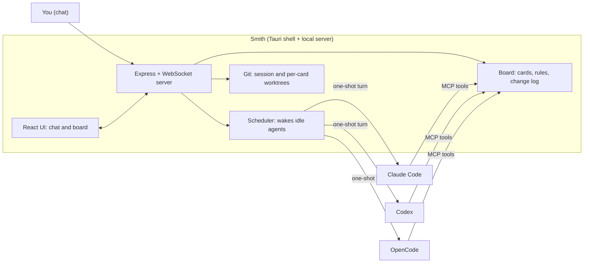

# Smith

[](https://github.com/jeeyo/smith/actions/workflows/ci.yml)
[](https://github.com/jeeyo/smith/actions/workflows/release.yml)
[](LICENSE)

Smith is a desktop app in which a team of coding agents works on your goal together. The agents are the CLIs you already use (**Claude Code**, **Codex**, **OpenCode**), running on your existing logins. Nobody leads the team: the agents plan on one shared board, claim cards, hand work to each other, and change the plan when something does not go as expected.

---

## Key features

- **A shared board.** A goal becomes cards with acceptance criteria, file scopes and dependencies. Every agent reads and edits the same board through MCP tools.
- **No lead agent.** Agents pull work. The server only enforces rules: one claimer per card, no overlapping file scopes, changes to someone else's card are proposals, reviews are done by a different agent.
- **A plan that adapts.** Any agent can add, split, block, cancel or hand on a card, with a recorded reason. Failed turns, rejected reviews and merge conflicts put work back on the board.
- **Isolated git work.** Each session has its own worktree and branch; each card has its own branch, checked against the card's file scope before it is merged. Your checkout is never touched.
- **Review modes.** Fast (no card reviews), Normal (larger or riskier cards) or Thorough (every card). The finished goal is always verified.
- **Questions come to you.** When only you can decide, or the spec looks wrong, the card waits for your answer. Agents never change the spec.
- **Usage limits handled.** A CLI and model that hits its subscription limit leaves the team, its cards return to the board, and it rejoins after the reset.
- **Tauri 2 desktop app** for macOS, with a local server on port 4100 and API docs at `/api/docs`.

## 🚀 Quick Start

### Option A: Installing on macOS via Homebrew (Desktop App)

Install Smith directly onto macOS via Homebrew Cask from this repository:

```bash
brew tap jeeyo/smith https://github.com/jeeyo/smith
brew install --cask smith
```

Or install directly in one command:

```bash
brew install --cask https://raw.githubusercontent.com/jeeyo/smith/main/Casks/smith.rb
```

This installs `Smith.app` into `/Applications` and creates a `smith` CLI alias in your terminal.

---

### Option B: Running Locally from Source

#### Prerequisites
- [Node.js](https://nodejs.org/) v22+
- Git
- At least one agent CLI, installed and logged in: [Claude Code](https://claude.com/claude-code), Codex or OpenCode

#### Installation

```bash
# Clone the repository
git clone https://github.com/jeeyo/smith.git
cd smith

# Install dependencies
npm install
```

#### Running in Development

```bash
# Launch the full Tauri native desktop app with live reload
npm run tauri:dev

# Or run web client + server in browser mode
npm run dev
```

#### Running Test Suite

```bash
# Run all unit, integration, and configuration tests
npm test
```

#### Packaging Desktop Installers

```bash
# Full build and packaging of native Tauri installers for current OS
npm run tauri:build
```

The output packages will be located in the `src-tauri/target/release/bundle/` directory.

---

## Architecture overview



For more detail, see:
- [Design: the peer board](docs/designs/peer-board.md)
- [Technical architecture](docs/TECHNICAL_ARCHITECTURE.md)
- [User manual](docs/USER_MANUAL.md)

---

## 🔄 CI / CD

- **CI (`.github/workflows/ci.yml`)**: Automatically triggers on all pull/merge requests and pushes to `main`. Installs dependencies, builds all targets, validates Tauri shell compilation, and runs the Vitest test suite.
- **Automated Releases (`.github/workflows/release.yml`)**: Triggers on every semantic tag push matching `vX.X.X` (e.g., `v0.1.0`):
  1. Builds multi-platform Tauri desktop installers (Windows `.exe`/`.msi`, Linux `.AppImage`/`.deb`, macOS `.dmg`).
  2. Automatically updates and commits the Homebrew Cask formula `Casks/smith.rb` with the new version and calculated SHA256 checksums.
  3. Publishes an official GitHub Release with auto-generated release notes and attached desktop binary artifacts.

---

## 📜 License

Licensed under the Apache License, Version 2.0. See [LICENSE](LICENSE) for details.
