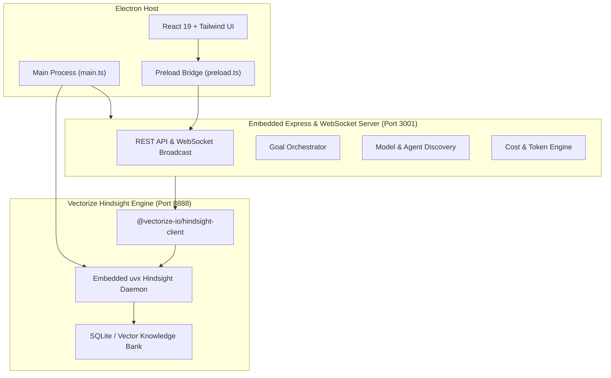

# Smith ADE (Agentic Development Environment)

[](https://github.com/jeeyo/smith/actions/workflows/ci.yml)
[](https://github.com/jeeyo/smith/actions/workflows/release.yml)
[](LICENSE)

Smith ADE is a high-performance, API-first **Cooperative Agentic Development Environment** packaged as a cross-platform desktop application using **Electron**. It provides dual-layer persistent memory powered by the official **Vectorize Hindsight** daemon, real-time multi-agent orchestration, interactive human-in-the-loop clarifications, dynamic model discovery, and cost telemetry.

---

## 🌟 Key Features

- 🖥️ **Cross-Platform Electron Desktop App**: Single-window desktop experience with native lifecycle management, hardware acceleration, and integrated background server supervision.
- 🧠 **Embedded Vectorize Hindsight Daemon**: Zero-friction embedded memory engine using `@vectorize-io/hindsight-all` and `uvx hindsight-embed`, providing persistent bank storage, cross-session episodic memory, facts, and anti-patterns.
- 🤖 **Goal Orchestrator & Multi-Agent Swarms**: Autonomous orchestrator backed by real agent harnesses (Claude Code, Antigravity, OpenCode, Aider) with support for parallel multi-worker execution.
- 💬 **Interactive Human-In-The-Loop**: Native support for agent questionnaires (`ask_question`), interactive decision prompts, and unified chat streaming.
- ⚡ **Dual-Layer Memory**: High-speed in-memory short-term cache combined with long-term semantic knowledge banks.
- 📊 **Real-Time Telemetry & Costs**: Live token usage, financial expenditure breakdown, and active agent execution tracing.
- 📖 **Interactive OpenAPI Documentation**: Embedded Swagger UI available at `/docs` with live REST endpoints.

---

## 🚀 Quick Start

### Prerequisites
- [Node.js](https://nodejs.org/) v22+
- [Astral `uv`](https://docs.astral.sh/uv/) (required for Hindsight daemon and Python-based tool runtimes)
- Git

### Installation

```bash
# Clone the repository
git clone https://github.com/jeeyo/smith.git
cd smith

# Install dependencies
npm install
```

### Running in Development

```bash
# Run web client + server in development mode
npm run dev

# Or launch the full Electron desktop app with live reload
npm run electron:dev
```

### Running Test Suite

```bash
npm test
```

### Packaging Desktop Installers

```bash
# Full build and packaging for current OS
npm run electron:dist

# Pack unpacked directory without installer
npm run electron:pack
```

The output packages will be located in the `release/` directory.

---

## 🏛️ Architecture Overview



For more details, see:
- [Technical Architecture](docs/TECHNICAL_ARCHITECTURE.md)
- [User Manual](docs/USER_MANUAL.md)

---

## 🔄 CI / CD Workflows

- **CI (`.github/workflows/ci.yml`)**: Automatically triggers on all pull/merge requests and pushes to `main`. Installs dependencies with `uv`, builds all targets, and runs the Vitest test suite.
- **Automated Releases (`.github/workflows/release.yml`)**: Triggers on every semantic tag push matching `vX.X.X` (e.g., `v1.0.0`). Extracts the semantic version, builds multi-platform installers (Windows `.exe`/`.zip`, Linux `.AppImage`/`.tar.gz`, macOS `.dmg`/`.zip`), and publishes a GitHub Release with auto-generated release notes and attached binary artifacts.

---

## 📜 License

Licensed under the Apache License, Version 2.0. See [LICENSE](LICENSE) for details.
