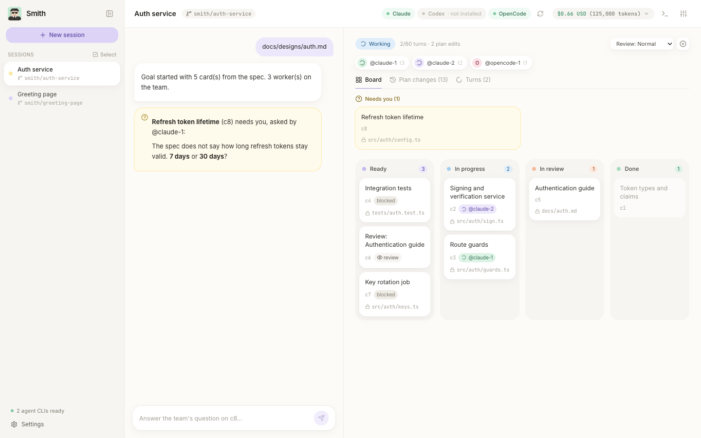
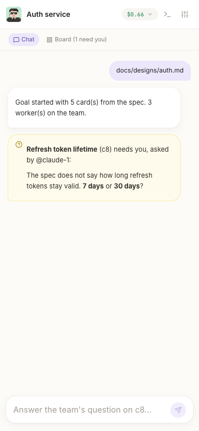
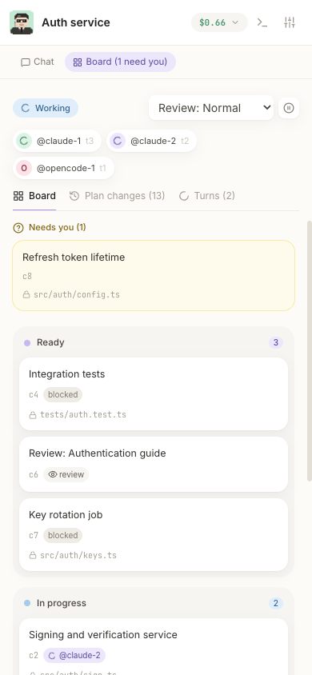
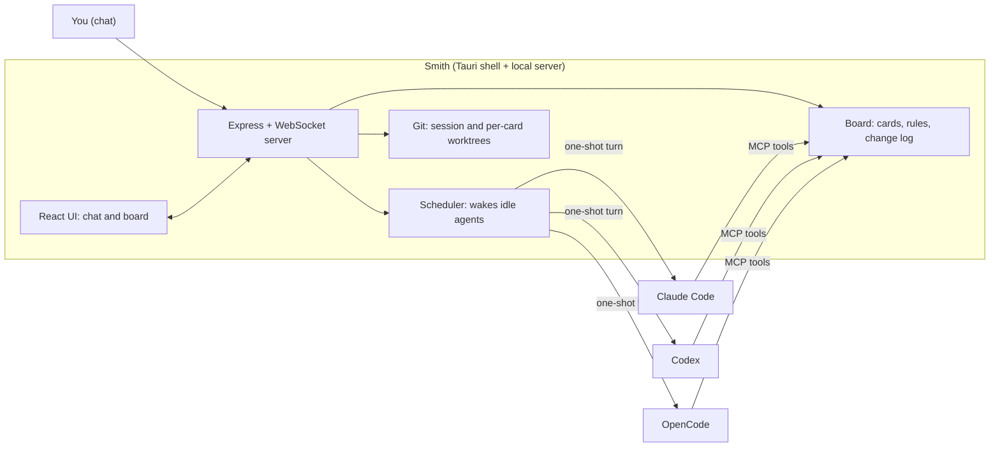

<p align="center"></p>

<h1 align="center">Smith</h1>

<p align="center">

[](https://github.com/jeeyo/smith/actions/workflows/ci.yml)
[](https://github.com/jeeyo/smith/actions/workflows/release.yml)
[](LICENSE)

</p>

Smith is a desktop app in which a team of coding agents works on your goal together. The agents are the CLIs you already use (**Claude Code**, **Codex**, **OpenCode**), running on your existing logins. Nobody leads the team: the agents plan on one shared board, claim cards, hand work to each other, and change the plan when something does not go as expected.



<p align="center">
  
  
</p>

---

## Key features

- **A shared board.** A goal becomes cards with acceptance criteria, file scopes and dependencies. Every agent reads and edits the same board through MCP tools.
- **No lead agent.** Agents pull work. The server only enforces rules: one claimer per card, no overlapping file scopes, changes to someone else's card are proposals, reviews are done by a different agent.
- **A plan that adapts.** Any agent can add, split, block, cancel or hand on a card, with a recorded reason. Failed turns, rejected reviews and merge conflicts put work back on the board.
- **Isolated git work.** Each session has its own worktree and branch; each card has its own branch, checked against the card's file scope before it is merged. Your checkout is never touched.
- **Review modes.** Fast (no card reviews), Normal (larger or riskier cards) or Thorough (every card). The finished goal is always verified.
- **Questions come to you.** When only you can decide, or the spec looks wrong, the card waits for your answer. Agents never change the spec.
- **Usage limits handled.** A CLI and model that hits its subscription limit leaves the team, its cards return to the board, and it rejoins after the reset.
- **Session setup in plain language.** Ask Smith to create a session in a folder and branch with the exact worker mix you want. The create dialog also includes a folder browser and Git branch dropdown.
- **Skills and external tools.** Import complete third-party skill packages and connect stdio or Streamable HTTP MCP servers, including OAuth. Choose which workers receive them.
- **Smith as MCP.** The unauthenticated, stateless Streamable HTTP endpoint at `http://127.0.0.1:4100/mcp` exposes Smith management tools to workers and external clients.
- **Markdown throughout.** Chat messages and card details render headings, lists, tables, fenced code and Mermaid diagrams.
- **Tauri 2 desktop app** for macOS, with a local server on port 4100 and API docs at `/api/docs`.

## 🚀 Quick Start

### Option A: Installing on macOS via Homebrew (Desktop App)

Smith's cask lives in this repository, which doubles as a Homebrew tap:

```bash
brew tap jeeyo/smith https://github.com/jeeyo/smith
brew trust --tap jeeyo/smith
brew install --cask smith
```

Homebrew 7 only loads casks from taps you have trusted, and no longer installs a cask straight from a URL. If `brew install` still refuses, run the `brew trust` command it suggests.

This installs `Smith.app` into `/Applications`, links a `smith` command that launches it, and pulls in `git` and `node@22`, which the app runs its server with. Smith is not yet signed or notarised, so the cask clears the download's quarantine flag after installing.

---

### Option B: Running Locally from Source

#### Prerequisites
- [Node.js](https://nodejs.org/) v22+
- Git
- At least one agent CLI, installed and logged in: [Claude Code](https://claude.com/claude-code), Codex or OpenCode

#### Installation

```bash
# Clone the repository
git clone https://github.com/jeeyo/smith.git
cd smith

# Install dependencies
npm install
```

#### Running in Development

```bash
# Launch the full Tauri native desktop app with live reload
npm run tauri:dev

# Or run the server and web client in separate terminals
npm run server
npm run dev
```

The development UI is at `http://localhost:5173`; the server and API docs are on port 4100.

#### Trying it with sample data

```bash
# Starts the app with two sample sessions and scripted workers; no agent CLI is run
npm run build && node --import tsx scripts/demo-server.ts
```

Then open `http://localhost:4199`. This is how the screenshots in the docs are made.

#### Running Test Suite

```bash
# Run all unit, integration, and configuration tests
npm test
```

#### Packaging Desktop Installers

```bash
# Full build and packaging of native Tauri installers for current OS
npm run tauri:build
```

The output packages will be located in the `src-tauri/target/release/bundle/` directory.

---

## Architecture overview



For more detail, see:
- [Design: the peer board](docs/designs/peer-board.md)
- [Technical architecture](docs/TECHNICAL_ARCHITECTURE.md)
- [User manual](docs/USER_MANUAL.md)

---

## 🔄 CI / CD

- **CI (`.github/workflows/ci.yml`)**: Automatically triggers on all pull/merge requests and pushes to `main`. Installs dependencies, builds all targets, validates Tauri shell compilation, and runs the Vitest test suite.
- **Automated Releases (`.github/workflows/release.yml`)**: Triggers on every semantic tag push matching `vX.X.X` (e.g., `v0.1.0`):
  1. Builds Tauri desktop installers for macOS (`.dmg`, Apple silicon and Intel) and Linux (`.AppImage`, `.deb`).
  2. Automatically updates and commits the Homebrew Cask formula `Casks/smith.rb` with the new version and calculated SHA256 checksums.
  3. Publishes an official GitHub Release with auto-generated release notes and attached desktop binary artifacts.

---

## 📜 License

Licensed under the Apache License, Version 2.0. See [LICENSE](LICENSE) for details.
