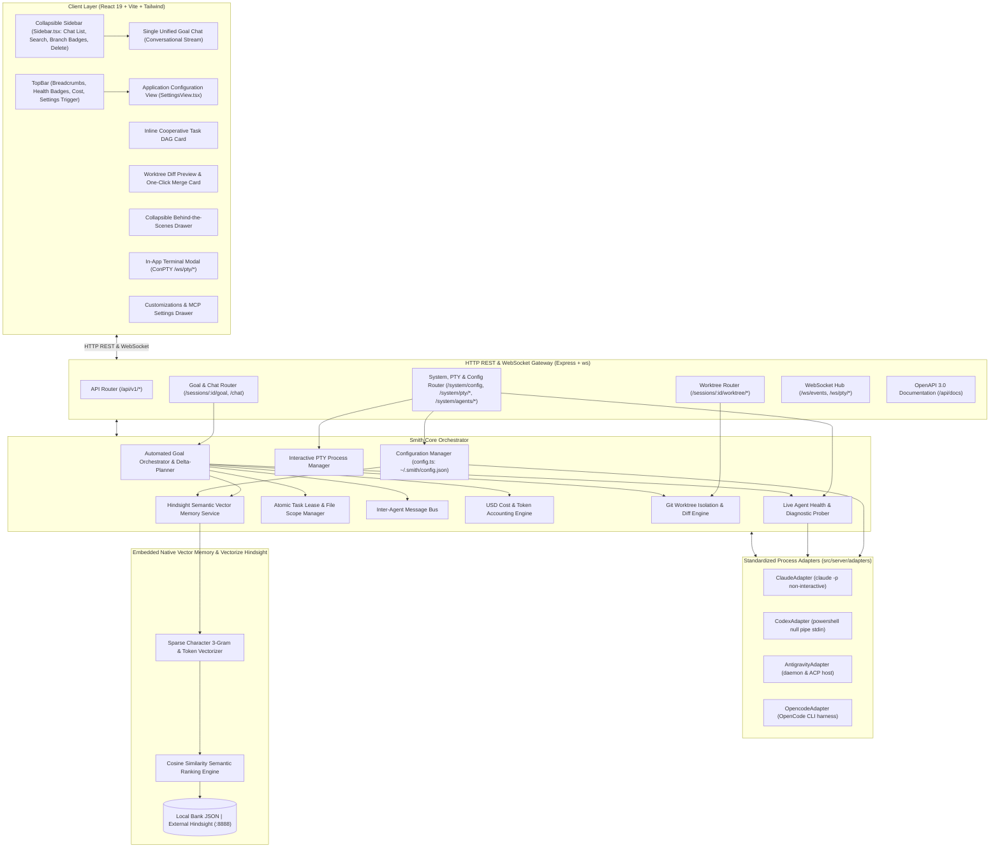

# Smith Technical Architecture & Contributor Guide

This document details the internal architecture, protocol specifications, data flows, and design decisions of **Smith**—an API-first, cooperative Agentic Development Environment (ADE).



---

## 1. The Protocol Triad

Smith achieves vendor-neutral agent orchestration by unifying three open standards:

```
┌────────────────────────────────────────────────────────────────────────┐
│                        The Smith Protocol Triad                        │
├────────────────────────────────────────────────────────────────────────┤
│ 1. ACP (Agent Client Protocol)                                         │
│    - Role: Host ↔ Agent Processes                                      │
│    - Transport: stdio JSON-RPC 2.0                                     │
│    - Features: initialize, session/prompt, session/stream,             │
│      session/configure, permission/request                             │
│                                                                        │
│ 2. MCP (Model Context Protocol)                                        │
│    - Role: Agents ↔ Tools, Skills & Custom MCP Servers                 │
│    - Multiplexer: Session MCP Gateway (`src/server/mcp-gateway.ts`)    │
│    - Capabilities: retain, recall, reflect, claim_task, broadcast      │
│                                                                        │
│ 3. Vectorize Hindsight Official SDKs & Native Semantic Vector Engine   │
│    - Role: Authoritative Shared Memory & Beliefs Engine                │
│    - Daemon Supervisor: @vectorize-io/hindsight-all (HindsightServer)  │
│    - Client SDK: @vectorize-io/hindsight-client (HindsightClient)      │
│    - Offline Fallback: Embedded subword/token sparse vector cosine     │
│      similarity engine with persistence in ~/.smith/banks/             │
└────────────────────────────────────────────────────────────────────────┘
```

---

## 2. Dedicated Agent Process Adapters

Located in `src/server/adapters/`:
Each local agent CLI presents specific operating system and stdio quirks on Windows and Unix:

```
src/server/adapters/
├── types.ts                # AgentAdapter & AdapterExecutionResult interfaces
├── claude.adapter.ts       # Non-interactive -p execution & /login detection
├── codex.adapter.ts        # PowerShell null-pipe ($null |) stdin EOF handling
├── antigravity.adapter.ts  # Daemon language_server / agy socket harness
├── opencode.adapter.ts     # OpenCode CLI harness & dynamic binary resolution
└── index.ts                # getAgentAdapter(agentId) registry
```

### Stdio Handling & Binary Override Specifications:
* **Claude (`claude.adapter.ts`)**:
  - Claude CLI blocks if standard input is attached but idle. The adapter executes via `-p "<prompt>"` with `stdio: ['ignore', 'pipe', 'pipe']` and parses stdout/stderr for `Not logged in` and `/login` prompts.
  - Dynamically reads `config.agentBinaries.claude` with fallback to `Claude-Data` or global npm path.
* **Codex (`codex.adapter.ts`)**:
  - Codex CLI blocks waiting for stdin EOF on Windows. The adapter runs `$null | & "${bin}" exec "${prompt}" --skip-git-repo-check` and detects rate-limiting signatures (`usage limit reached. Resets at [time]`).
  - Reads `config.agentBinaries.codex`.
* **Antigravity (`antigravity.adapter.ts`)**:
  - Connects to the local Google Antigravity `language_server.exe` daemon or simulated ACP session with guaranteed zero-conflict task leases.
  - Reads `config.agentBinaries.antigravity`.
* **OpenCode (`opencode.adapter.ts`)**:
  - Executes local models and OpenCode command line tasks.
  - Reads `config.agentBinaries.opencode`.

---

## 3. Pre-Flight Health-Aware Task Allocation

Before decomposing or dispatching tasks, `GoalOrchestrator` queries `agentHealthEngine.getAll()`:

```mermaid
flowchart TD
    GoalDeclared["User Declares Goal"] --> HealthCheck["Probe Live Agent Health (agentHealthEngine)"]
    HealthCheck --> IsHealthy{"Is Assigned Agent Ready?"}
    IsHealthy -->|Yes (ready)| AssignDirect["Assign to Primary Agent (e.g. @codex)"]
    IsHealthy -->|No (rate_limited or not_logged_in)| AutoRoute["Auto-Route to Ready Fallback (@antigravity)"]
    AutoRoute --> TagMetadata["Annotate: routedFrom: @claude, routingReason: Not Logged In"]
    AssignDirect --> DAG["Generate Cooperative Task DAG"]
    TagMetadata --> DAG
    DAG --> Render["Render UI Pill: @antigravity (routed from @claude)"]
```

When an agent is rate-limited or unauthenticated:
1. Subtask assignment dynamically shifts to an active, unblocked agent (defaulting to `@antigravity`).
2. Subtasks carry `routedFrom` and `routingReason` metadata.
3. The UI renders `@antigravity (routed from @claude)` with tooltips and warning banners providing immediate remediation actions.

---

## 4. Conversational Delta-Planning

Follow-up user prompts must not re-trigger cumbersome 3-phase macro decompositions:
1. `GoalOrchestrator.executeGoal` checks if prior completed orchestrator messages with an existing plan exist.
2. If `isConversationalDelta === true`:
   - Extracts focused intent from user prompt (e.g. test refinement, schema update).
   - Generates a **single targeted delta task**:
     - Locks only the specific file scope (e.g. `tests/*` or `src/auth/*`).
     - Preserves the active worktree branch and existing files.
     - Submits completion reflection to Hindsight memory.

---

## 5. Worktree Git Diff Preview & One-Click Merge

Located in `src/server/worktree-manager.ts` and `src/server/routes/worktree.router.ts`:

- **Diff Extraction**: Computes structured changes (`+additions`, `-deletions`, status per file) against `baseBranch` or `HEAD`.
- **Clean Merge Verification**: Validates that changes can merge cleanly without Git conflict markers.
- **REST Endpoints**:
  - `GET /api/v1/sessions/:id/worktree/summary`
  - `POST /api/v1/sessions/:id/worktree/merge` -> Executes non-fast-forward merge into `main` and returns commit SHA.
  - `POST /api/v1/sessions/:id/worktree/discard` -> Resets worktree state.
- **Root Workspace Safety Isolation**:
  - `WorktreeManager` includes explicit safety guards preventing `mergeWorktree` or `discardWorktree` from running destructive `git checkout` or `git reset --hard` on `process.cwd()` or during test runs.

---

## 6. Artifact Pipeline & Preview Architecture

Located in `src/client/components/ArtifactPreview.tsx`, `src/client/components/GoalChat.tsx`, and `src/server/routes/worktree.router.ts`:

Smith enables agents to output rich deliverables that render automatically in the chat stream:

```
Agent Execution / Deliverables
      │
      ├── .mmd / ```mermaid ────> Client Mermaid.js v12 -> Rendered Inline SVG
      ├── .html / ```html   ────> Sandboxed <iframe> (allow-scripts allow-forms allow-same-origin allow-modals)
      │                           └─ Viewport toggles: Desktop (100%), Tablet (768px), Mobile (375px)
      ├── Images (.svg/.png) ───> Responsive Checkerboard Canvas + Zoom/Fit Controls
      ├── Interactive Questions ─> Multi-Choice Options Modal (ask_question)
      └── Other (.json/.pdf) ───> Direct File Card with One-Click Attachment Download
```

### Security & Directory Traversal Protection:
- The worktree file-serving endpoint (`GET /api/v1/sessions/:id/worktree/file`) normalizes the requested path using `path.resolve` and verifies that the canonical target resides strictly within the session's isolated `worktree.path` or `session.repoPath`.
- Any attempt to escape the worktree root using relative paths (`../../`) triggers a strict `403 Forbidden` response (`Directory traversal denied`).
- Non-previewable file downloads set `Content-Disposition: attachment; filename="<basename>"`.

---

## 7. Embedded In-App Terminal Architecture

Located in `src/server/pty-manager.ts` and `src/client/components/TerminalModal.tsx`:

- Spawns interactive pseudo-terminal sessions using system ConPTY / `powershell.exe`.
- Bridges bidirectional text streaming via WebSocket `/ws/pty/:ptyId`.
- Provides instant one-click execution for `claude login` or ChatGPT CLI authentication directly within the browser interface.
- Automatically re-probes agent health upon modal exit.

---

## 8. Vectorize Hindsight Official SDKs & Native Vector Memory

Located in `src/server/hindsight-service.ts`:

- **Daemon Lifecycle Supervisor (`@vectorize-io/hindsight-all`)**:
  - Automatically manages the local Hindsight daemon using `HindsightServer({ port: 8888 })`.
  - Probes daemon health and attempts programmatic startup via `uvx hindsight-embed` without requiring manual Docker commands.
- **Client SDK (`@vectorize-io/hindsight-client`)**:
  - Uses typed `HindsightClient({ baseUrl })` for executing `createBank`, `retain`, `recall`, and `reflect` memory operations against the running daemon.
- **Embedded Native Semantic Vector Engine (Offline Fallback)**:
  - If the daemon cannot be spawned (e.g. `uvx` not present in host environment), Smith seamlessly falls back to an embedded vector similarity engine.
  - **Sparse Subword Vectorizer**: Tokenizes text into lowercase words and character 3-grams (`c[i..i+3]`), applying term-frequency weighting and L2 normalization:
    $$\|V\| = \sqrt{\sum w_i^2}$$
  - **Cosine Similarity Ranker**:
    $$\text{sim}(Q, D) = \sum_{t \in Q \cap D} Q_t \cdot D_t$$
  - Ranks domain facts, experiences, and anti-patterns with millisecond latency, enabling zero-config semantic search completely offline.

---

## 9. Decentralized In-IDE Broadcast Chat Layer

Located in `src/server/broadcast-layer.ts` and `src/server/team-bus.ts`:

- **Peer-to-Peer Protocol**: Enables agents to negotiate dynamic task allocation, broadcast emergency coordinate alerts (build fails, test runner crashes, rate limit lockouts with timeout countdowns), and publish error retractions.
- **Direct Context Ingestion**:
  - Automatically captures unread peer broadcast messages and injects them directly into the standard context of teammates prior to each turn execution cycle.

---

## 10. Per-Session Dual-Layer Persistent Memory & Compaction Survival

Located in `src/server/session-memory.ts`:

- **Per-Session Hierarchy**: Rooted under `.smith/memory/sessions/{sessionId}`.
  - **Shared Team Workspace (`team/knowledge.md`)**: Synchronized markdown workspace for architecture contracts, API schemas, and certified milestones.
  - **Private Agent Scratchpads (`agents/{agentId}/scratchpad.md`)**: Private task stacks and execution hypotheses isolated per agent.
- **Compaction Survival Routine**:
  - When context limits threaten roll-overs, prompts agents to serialize durable findings into `team/knowledge.md`.
  - Clears working scratchpads to compact memory while guaranteeing critical facts survive indefinitely.

---

## 11. The Observer Agent: Independent Safety & Verification Harness

Located in `src/server/observer-agent.ts`:

- **The 5th Instance (`@observer`)**: A passive, non-coding agent instance that audits telemetry, git diffs, and execution traces.
- **Hallucination Detection**: Audits ground-truth files on disk to confirm claimed edits and test files actually exist.
- **Specification Gaming Scans**: Flags empty test blocks, `@ts-ignore` abuse, and hardcoded validation stubs.
- **Milestone Ground-Truth Certification**: Signs off on completion milestones with confidence metrics before presenting completed goals to users.

---

## 12. Application Configuration & Binary Probing Architecture

Located in `src/server/config.ts` and `src/server/routes/system.router.ts`:

```
~/.smith/config.json
├── agentBinaries: { claude, antigravity, opencode, codex, uv }
├── hindsight: { provider, apiKey, url, autoStartDaemon, defaultBank }
└── app: { gitPath, defaultRepoPath, port, currency, budgetAlertThreshold }
```

- **Persistence Layer**: Reads and saves global configuration in `~/.smith/config.json`.
- **System Binary Scanner (`detectDefaultBinaries`)**: Probes default Windows and Unix installation paths for `git.exe`, Claude Code (`Claude-Data`, npm global), Google Antigravity (`language_server.exe`, `agy-node.cmd`), OpenCode, and Astral `uv`.
- **Live On-Disk Verification (`POST /api/v1/system/config/probe-binary`)**: Checks direct file path existence or resolves through system `PATH` using `where.exe`/`which`, returning `{ exists, isExecutable, resolvedPath }`.
- **Live Hindsight Latency Probe (`POST /api/v1/system/config/test-hindsight`)**: Queries the target Hindsight URL with timeout abort controllers and returns round-trip ping latency in milliseconds.
- **Dynamic Adapter Hot-Apply**: Updating settings hot-applies changes immediately to running adapters without dropping active sessions.

---

## 13. Docker & Multi-Architecture Containerization Architecture

Located in `Dockerfile` and `.github/workflows/release.yml`:

Smith ADE is containerized as a production-grade multi-architecture container (`linux/amd64` and `linux/arm64`) for server and headless deployments:

```
Docker Container Pipeline
      │
      ├── Base Image ───────────────> node:22-bookworm-slim (amd64 / arm64)
      ├── Toolchain Extraction ─────> Astral uv & uvx (/usr/local/bin) from ghcr.io/astral-sh/uv
      ├── Python Runtime ───────────> Python 3.12 managed via uv (UV_PYTHON=3.12)
      ├── Memory Daemon Cache ──────> uv tool install hindsight-embed && uvx hindsight-embed
      ├── Multi-Stage Bundling ─────> Stage 1: Vite client (dist/) + esbuild server (dist-server/)
      │                              Stage 2: Production runtime with --omit=dev dependencies
      └── Multi-Platform Publish ───> GitHub Container Registry (ghcr.io/jeeyo/smith:latest, :vX.X.X)
```

### Key Container Specifications:
1. **Pre-Warmed Vectorize Hindsight Tool Cache**:
   - Running `uv tool install hindsight-embed` and `uvx hindsight-embed --help` during image build compiles Python wheels and primes the tool cache inside `/root/.local/` and the uv cache.
   - At runtime, `@vectorize-io/hindsight-all` executes `uvx hindsight-embed` with **zero network latency** and complete offline capability.
2. **Multi-Architecture Matrix (`linux/amd64` & `linux/arm64`)**:
   - Cross-compiled via GitHub Actions using `docker/setup-qemu-action` and `docker/setup-buildx-action`.
   - Native execution on Intel/AMD servers and ARM64 cloud instances (AWS Graviton, Apple Silicon servers).
3. **Container Healthcheck**:
   - Automated `HEALTHCHECK` periodically pings `http://localhost:4100/api/v1/health` with a 20-second interval and 10-second start grace period.
4. **Volumes & Data Persistence**:
   - Persists session memory, Git worktrees, and application settings by mounting a host volume to `/root/.smith`.

---

## 14. Automated Test Suite

Run all automated unit, integration, and configuration tests with vitest:
```bash
npm test
```

Test coverage includes 10 test suites and **54 passing tests**:
- `tests/system-config.test.ts`: App-level configuration CRUD, JSON persistence, binary verification, and Hindsight connectivity probes.
- `tests/api.test.ts`: REST endpoints, session CRUD, and health probes.
- `tests/cost-engine.test.ts`: Real-time USD pricing and token accounting.
- `tests/goal-orchestrator.test.ts`: Zero-racing task decomposition, health-aware task rerouting, conversational delta-planning, worktree merge endpoints, artifact generation, and observer signoff.
- `tests/hindsight-service.test.ts`: Persistent memory, anti-pattern retain/recall, and local sparse vector semantic similarity ranking.
- `tests/dual-layer-memory.test.ts`: Per-session dual-layer file hierarchy (`team/knowledge.md` vs `agents/{agentId}/scratchpad.md`) and compaction survival.
- `tests/broadcast-layer.test.ts`: Peer proposals, consensus voting, emergency coordinate alerts, error retractions, and context ingestion.
- `tests/observer-agent.test.ts`: Passive telemetry audit, hallucination detection, specification gaming detection, and milestone certification.
- `tests/model-discovery.test.ts`: CLI and ACP model discovery.
- `tests/task-lease-manager.test.ts`: Atomic lease claims and 409 conflict detection.
