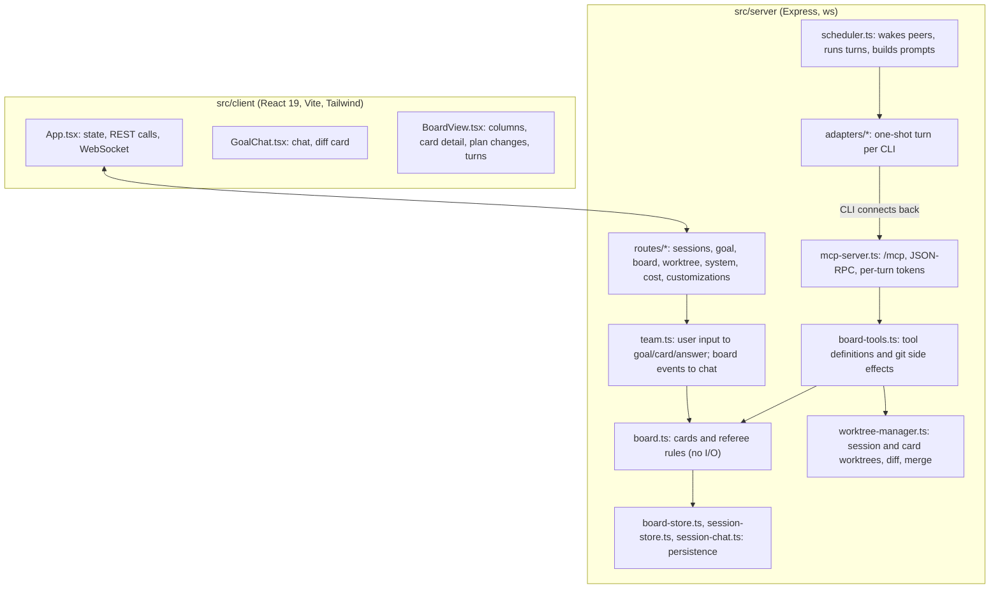

# Smith technical architecture

Smith is a local server with a React UI, wrapped in a Tauri 2 shell. The design is described in [designs/peer-board.md](designs/peer-board.md); this document maps it to the code.

## 1. The board (`board.ts`, `shared/board.ts`)

`Board` holds the cards for one session and decides whether a change is allowed. It performs no I/O and takes its clock as a parameter, so the rules are unit-tested directly (`tests/board.test.ts`).

- **Card states:** `ready`, `claimed`, `in_review`, `done`, `blocked`, `failed`, `cancelled`, `needs_user`.
- **Card kinds:** `plan`, `work`, `review`, `verify`, `merge-conflict`.
- **Versions:** `version` increases on every accepted change. `planVersion` increases only when the plan itself changes (cards created, split, edited, cancelled, blocked). Plan-editing tools must send the `planVersion` they read; a stale one is refused.
- **Log:** every accepted change produces a `BoardLogEntry` (actor, action, card, reason).
- **File scopes:** `matchesScope` and `scopesOverlap`. A trailing `/*` means the whole directory. Overlap checks err towards reporting an overlap.

Rules enforced in `claimBlocker`, `submit`, `edit`, `delegate`, `bounce` and friends correspond to section 5 of the design doc. `bounce` also raises a card's minimum tier after repeated failures at one tier, and sends a card to the user at the bounce limit.

`parseSpecTasks` reads the `smith-tasks` block at the end of a spec.

## 2. Persistence (`board-store.ts`, `session-store.ts`, `session-chat.ts`)

Everything is under the storage directory (`~/.smith`, or `SMITH_STORAGE_DIR`; tests use a temp directory):

| Path | Content |
|---|---|
| `sessions/<id>.json` | Session: repository, worktree, workers, review mode, customizations |
| `boards/<id>.json` | Board, rewritten atomically on every change |
| `boards/<id>.log.jsonl` | Append-only change log |
| `chats/<id>.json` | Session conversation |
| `specs/<id>.md` | Spec, when the goal was typed in the chat |
| `config.json` | App settings |

`BoardStore` emits `changed` after each board change. The WebSocket hub, the scheduler and `team.ts` all listen to it.

## 3. Board tools and MCP (`board-tools.ts`, `mcp-server.ts`)

`BOARD_TOOLS` lists the fourteen tools: `board_read`, `card_claim`, `card_note`, `card_submit`, `card_release`, `card_block`, `card_create`, `card_split`, `card_edit`, `card_cancel`, `card_delegate`, `proposal_answer`, `review_verdict`, `ask_user`.

`BoardTools.call` applies a tool for one peer and adds the git work:

- **claim:** creates the card's branch and worktree (`<session branch>--<card id>`). For a merge-conflict card it reuses the target card's branch and merges the session branch into it, leaving the conflict markers. For a review card it returns the diff.
- **submit:** commits everything in the card worktree, computes the diff against the session branch, refuses changes to the spec file, and passes the diff to `Board.submit`, which checks the scope and decides whether a review is needed.
- **merge:** serialised per session. A clean merge marks the card done and removes its worktree. A conflict is aborted and becomes a merge-conflict card.

`mcp-server.ts` serves the tools at `POST /mcp` as JSON-RPC 2.0 with one JSON response per request (`initialize`, `tools/list`, `tools/call`, `ping`). Every agent turn gets its own bearer token mapped to one peer in one session; the token is revoked when the turn ends.

If the session directory is not a real Git worktree (worktree creation failed and Smith fell back to a plain folder), cards are worked in that folder and scope checks and merges are skipped.

## 4. Scheduler (`scheduler.ts`)

`tick(sessionId)` runs on every board change, turn end and a 30-second timer, for goals in the `running` state:

1. Return expired leases and let removed peers whose reset time has passed rejoin.
2. For each idle peer whose CLI is healthy, in rotating order, ask the board for a wake reason: an open proposal on a card it holds, a claimed card to continue, or cards it may claim. Start a turn if there is one. Two peers are never pointed at the same claimable card.
3. Send cards nobody can take to the user.
4. If nothing is running: create the verify card when all cards are finished, record why the goal is waiting, or pause it when no peer can move any card.

`startTurn` issues the token, builds the prompt (`buildTurnPrompt`) and calls the adapter. `finishTurn` records usage, and handles the outcome: a usage limit removes the CLI and model from the team; a logged-out CLI is marked not ready; another failure bounces the peer's card; two turns in a row without a board tool call are treated as a failure.

The scheduler never chooses a card for a peer or edits the plan. `turnRunner` is replaceable, which is how `tests/team.test.ts` runs scripted peers through the real board, tools and git.

## 5. Adapters (`adapters/*`)

Each adapter has `probeHealth` (a `--version` call, which spends no usage) and `runTurn`.

| CLI | How the board is attached | Status |
|---|---|---|
| Claude Code | `claude -p --output-format json --mcp-config <file>`, prompt on stdin | Flags verified against the installed CLI; a full live run has not been done |
| Codex | `codex exec` with `-c mcp_servers.board.*` overrides, token in an environment variable | Not verified |
| OpenCode | `opencode run` with inline config in `OPENCODE_CONFIG_CONTENT` | Not verified |

All CLIs are spawned with real argument arrays and no shell (`process-utils.ts`). `adapters/shared.ts` recognises usage-limit and not-logged-in messages by matching text and extracts a reset time when it can.

## 6. Team (`team.ts`)

`handleUserInput` routes chat input: start a goal (first message, or after a completed goal), resume, answer the one waiting card (or the card named by an id prefix), or add a card. `startGoal` resolves the spec, parses its task list and seeds the board. `startTeamAnnouncements` turns board events into chat messages: questions, pauses, removals and rejoins, verification results and completion with a diff summary.

## 6a. Skills, MCP servers and plugins (`catalog.ts`)

The catalog holds the built-in entries plus any added through the API (saved in `catalog.json`). A session stores which skills, servers and plugins are on, input values for servers, and optional per-worker targets keyed `skill:<id>`, `mcp:<id>` or `plugin:<id>`.

`resolveFor(customizations, peerId, workdir)` works out what one worker gets on one turn: the session's own skills and servers plus those its plugins bring, limited to the ones targeting that worker, with `${WORKDIR}` and `${KEY}` placeholders filled in. A server still missing an input is left out; the API refuses to save such a state in the first place. The scheduler calls it for every turn, and each adapter attaches the resulting servers in its CLI's own way (an MCP config file, Codex `-c` overrides, OpenCode inline config). Secret input values are masked in every API response, and a mask sent back unchanged keeps the stored value.

## 7. Git (`worktree-manager.ts`)

All Git commands run through `execFile` with argument arrays; branch names are validated. Mutating commands run only in a directory that is the root of its own worktree (`isWorktreeRoot`), so a fallback folder inside the user's repository can never cause a commit, reset or clean on that repository.

## 8. HTTP, WebSocket and security (`index.ts`)

- REST under `/api/v1` (see `/api/docs`), the board for agents under `/mcp`, the built UI as static files.
- WebSocket events: `board:updated`, `chat:message`, `turn:started`, `turn:ended`, `cost:updated`; terminal streams under `/ws/pty/<id>`.
- The server binds to `127.0.0.1`. Requests and WebSocket connections carrying a browser `Origin` are accepted only from loopback or Tauri origins. Requests without an `Origin` (the desktop shell, agent CLIs, tests) are allowed.
- Files served from a session workspace are path-checked against the real worktree and repository paths and sent with a sandboxing Content-Security-Policy.

## 9. Desktop shell (`src-tauri`)

The Rust shell starts `dist-server/index.cjs` with the system Node, waits for `/api/v1/health`, then points the webview at `http://127.0.0.1:4100`. It kills the server on exit.

## 10. Look and feel

- **Palette** (`tailwind.config.js`): warm neutrals named `ink` for text, surfaces and lines, and six pastels that each carry one meaning: `mint` done and ready, `sky` in progress, `peach` review, `butter` waiting for the user, `rose` failures, `lav` primary actions and focus. Fills use 50 to 200, text on them 600 to 700.
- **Mascot** (`src/shared/logo.ts`): a 24 x 24 pixel grid and its palette. It is drawn as one SVG path per colour over a solid tile, with a slight overlap between colours, so no hairline seams appear at fractional scales such as phone pixel ratios. `Logo.tsx` draws it in the app; `npm run icons` writes `public/logo.svg`, `public/icon.png` and `docs/images/logo.png` from it and then regenerates the Tauri app icons.
- **Phones**: below 768 px the sidebar becomes a drawer opened from the logo, the chat and board become tabs, text fields use 16 px so iOS does not zoom in on focus, and the layout respects the screen's safe areas.
- **Screenshots** (`docs/images`): taken from `scripts/demo-server.ts`, which starts the server with two sample sessions and scripted workers, so no agent CLI runs.

## 11. Tests

`npm test` runs Vitest:

- `tests/board.test.ts`: scopes, spec parsing and every referee rule.
- `tests/team.test.ts`: whole goals with scripted peers over the real MCP endpoint and real Git repositories: planning, replanning, review by another peer, scope and spec refusals, merge conflict and resolution, usage-limit removal and rejoin, questions to the user, failure escalation, and requests added mid-goal.
- `tests/hardening.test.ts`: origin policy, shell-free spawning, worktree safety, file endpoint, pricing.
- `tests/system-config.test.ts`, `tests/cost-engine.test.ts`, `tests/model-discovery.test.ts`.

Port binding is required, so the suite does not run inside a sandbox that blocks local listeners.
