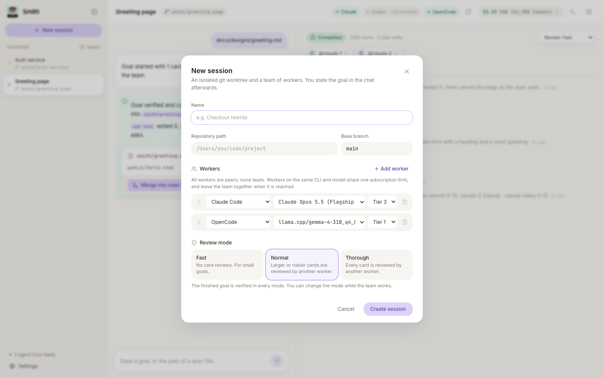
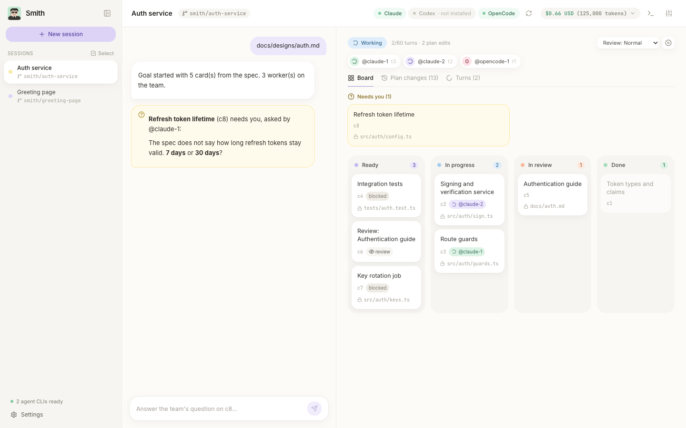
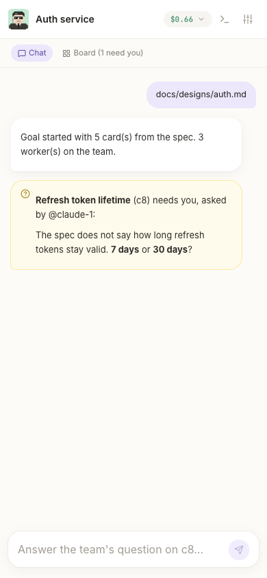
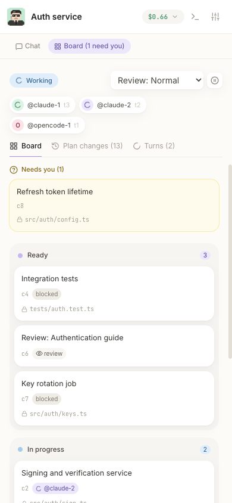
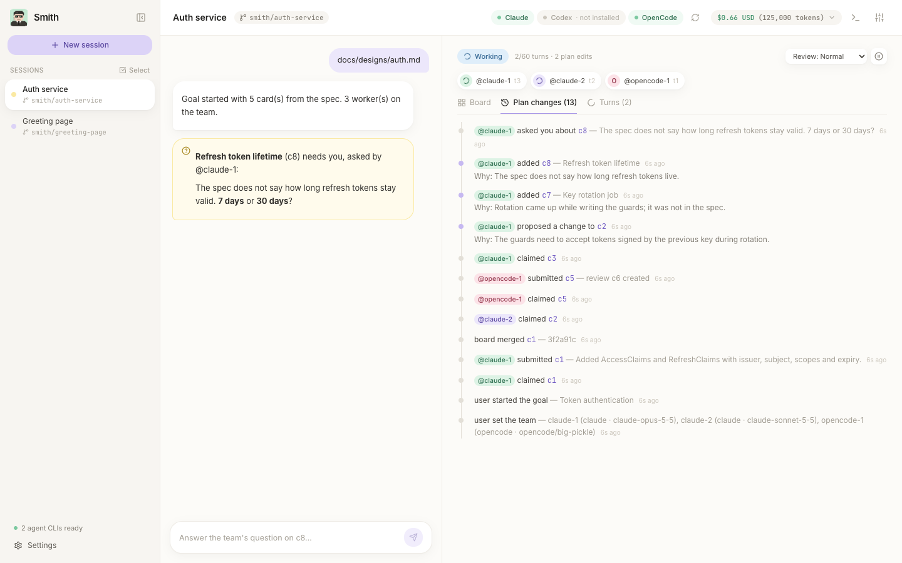
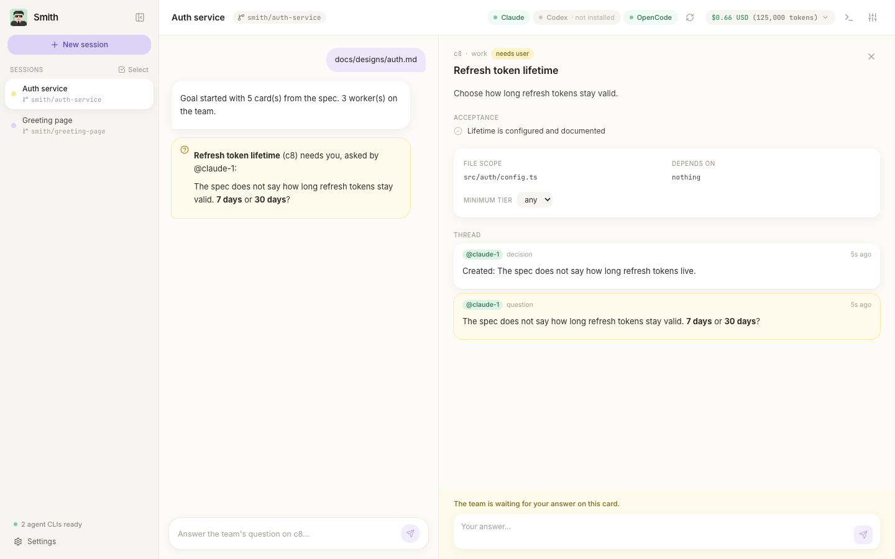
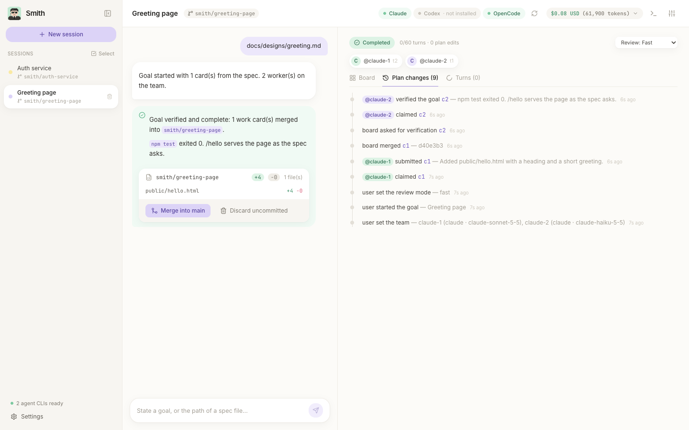
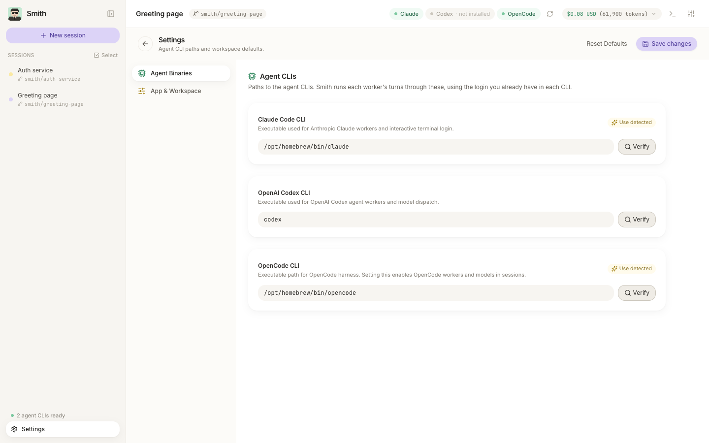

# Smith user manual

Smith runs a team of coding agents on a goal you state. The agents are the CLIs you already have (Claude Code, Codex, OpenCode), using the logins those CLIs already hold. Nobody leads the team. The agents coordinate through one shared board that you can watch and steer.

## 1. Before you start

- Node.js 22 or later, and Git.
- At least one agent CLI installed and logged in. Smith finds `claude`, `codex` and `opencode` on your `PATH`; you can set exact paths in **App settings → Agent Binaries**.
- A local Git repository to work in.

Start the app from source with `npm run tauri:dev`, or run `npm run server` and `npm run dev` in separate terminals. The development UI with live reload is at `http://localhost:5173` and the API reference at `http://localhost:4100/api/docs`. After `npm run build`, the server also serves the built UI at `http://localhost:4100`.

The server listens on `127.0.0.1` only. Set the `HOST` environment variable if you deliberately want it reachable from other machines.

## 2. Sessions

A session is an isolated Git worktree plus a team of workers. Create one with **New Session**:

- **Name** and **repository path**. Smith creates a branch `smith/<name>-<id>` and a worktree for it under `.worktrees/` in the repository. Your own checkout is not touched.
- **Browse** opens a folder selector. **Base branch** lists local and remote Git branches and initially selects the current branch.
- Use the root of an existing Git repository and a base branch with at least one commit. If creation fails, the dialog keeps your entries so you can correct the path or branch and retry.
- **Workers.** Each worker is a CLI and a model, for example Claude Code on Opus. Add as many as you like, including several on the same CLI. All workers are peers.
- **Tier.** A number from 1 to 3 saying how capable the worker's model is. Smith suggests one from the model name and you can change it. Tiers only matter if you mix stronger and weaker models: a card can require a minimum tier.
- **Review mode** (section 6).



Workers on the same CLI and model share one subscription limit. More workers on one subscription reach that limit sooner; they do not add capacity.

## 3. Stating a goal

Type the goal in the session chat. Two forms work:

- **Plain words.** Smith saves them as the spec. The first card on the board asks the team to break the goal into cards.
- **The path of a spec file in the repository**, for example `docs/designs/feature.md`. If the spec ends with a task list, those tasks become the first cards directly.

A task list is a fenced block tagged `smith-tasks` at the end of the spec:

````
```smith-tasks
{
  "verify": ["npm test"],
  "tasks": [
    { "id": "types", "title": "Token types", "description": "...",
      "acceptance": ["types compile"], "fileScope": ["src/auth/types.ts"] },
    { "id": "guards", "title": "Route guards", "description": "...",
      "acceptance": ["guards reject expired tokens"], "fileScope": ["src/auth/guards.ts"],
      "dependsOn": ["types"], "review": true }
  ]
}
```
````

`verify` lists the commands that prove the goal is met. `review: true` forces a review of that card in Normal mode. `minTier` restricts a card to stronger workers.

The spec is yours. Workers can read it but cannot change it; a card whose changes touch the spec file is refused.

## 4. The board



On a phone the chat and the board are two tabs, and the sessions list opens from the logo in the top-left corner.

<p>
  
  
</p>

The board is on the right of the chat. Each card shows its id, title, owner, file scope and state.

| State | Meaning |
|---|---|
| Ready | Can be claimed. Blocked cards also sit here until what they wait for is finished. |
| In progress | Claimed by one worker. |
| In review | Submitted; waiting for another worker's review or for the merge. |
| Done | Merged into the session branch, or cancelled. |
| Needs you | Waiting for your answer. Shown above the columns. |

Card kinds: **plan** (break the goal into cards), **work**, **review** (check another worker's card), **merge-conflict** (resolve a merge that conflicted) and **verify** (the final check).

Click a card to see its acceptance criteria, scope, dependencies, branch, and its thread: every note, proposal, decision and question on that card, in order.

Above the board:

- **Team.** One chip per worker. A spinner means it has a turn running; a greyed chip means it is away for a usage limit.
- **Plan changes.** The change log: who changed the plan, what they did and why.

  

- **Turns.** Each agent run, with its outcome.

## 5. How the team works

Workers run in short turns. Each turn starts with no memory: the worker is given the goal, one line per card, and the full thread of the card in hand. Anything a worker learns has to be written on a card, which is why the threads are worth reading.

In a turn a worker can:

- claim a ready card, do the work in the card's own worktree, and submit it;
- add, split, edit or cancel cards when the plan is wrong;
- block its card on another card it needs first;
- hand a card back, or offer it to a named worker;
- propose a change to a card someone else holds, which that owner accepts or rejects;
- ask you a question.

The server does not decide who does what. It enforces rules:

- The first claim on a card wins, and a worker holds one card at a time.
- Two cards in progress cannot have overlapping file scopes.
- When a card is submitted, Smith commits the worker's changes and compares them with the card's file scope. Changes outside the scope are refused.
- A review is never done by the card's author.
- A card cannot be handed back to someone who already passed it on, and can be handed on at most twice.
- A worker that fails a card does not get the next attempt while another worker is free.
- A lease expires after 20 minutes without a turn, and the card returns to the board.

When a card is done its branch is merged into the session branch. If the merge conflicts, it is aborted and a merge-conflict card is opened for a worker to resolve.

## 6. Review modes

| Mode | Which cards are reviewed by another worker |
|---|---|
| Fast | None. |
| Normal | Cards that change more than 150 lines or 5 files, cards the spec marked, cards whose author asked, and cards that came back at least once. |
| Thorough | All. |

Change the mode at any time from the board header; it applies to cards submitted afterwards. With a single worker there is nobody else to review, so no cards are reviewed.

In every mode, once all cards are finished, one worker runs the spec's verify commands and reports each exit code. The goal is complete when that passes. If it fails, the worker creates cards for what is wrong and the team continues.

## 7. When the team needs you



A card moves to **Needs you** when:

- a worker asks a question, including whenever the spec looks wrong or incomplete;
- a card has come back three times without being finished;
- nobody has taken a card for 30 minutes while workers were idle;
- no worker on the team meets the card's minimum tier.

The question appears in the chat and on the card. Answer on the card, or just type in the chat if only one card is waiting. With several waiting, start the message with the card id, for example `c4: use JSON`.

Anything else you type while a goal is running becomes a new card for the team.

The goal **pauses** when the team has used its turn budget (60 turns) or plan-edit budget (40 edits), or when no worker can move any open card. Read the reason on the board, then press **Resume** or type `resume`.

## 8. Usage limits

When a CLI reports that its subscription limit is reached, every worker on that CLI and model leaves the team. Their cards go back to the board without counting as failures, and the work already on each card's branch is kept for whoever takes it next. The other workers carry on.

A worker rejoins by itself: at the reset time when the CLI gives one, otherwise after ten minutes, when it is given a turn to try. If it is still limited it leaves again.

If every worker is away, the goal waits and the board shows the earliest reset time.

Smith recognises a usage limit by matching the CLI's error text. If a CLI changes its wording, the turn is treated as an ordinary failure instead.

If a CLI fails before reaching the board, Smith stops scheduling that harness and shows its error. Correct the CLI configuration, then re-check the agent CLIs to try again.

## 9. Finishing



When the goal is verified, the chat shows the diff summary of the session branch against its base branch, with two actions:

- **Merge into `<base>`** merges the session branch into the base branch in your repository. If that merge conflicts it is aborted and reported; nothing is left half-merged.
- **Discard uncommitted** resets uncommitted changes in the session worktree.

Deleting a session removes its worktrees and its board. The session branch stays in the repository.

## 10. Settings



- **Agent Binaries:** paths to `claude`, `codex` and `opencode`, with a check that each exists.
- **App & Workspace:** Git path, default repository path, server port, display currency.
- **Skills and tools** (sliders icon, per session). Changes apply from each worker's next turn.
  - **Skills** are conventions added to the worker's instructions.
  - **MCP servers** support local commands (stdio) and remote Streamable HTTP endpoints, for Claude Code, Codex and OpenCode workers alike. Use **Add third-party MCP server**, enter the command and JSON arguments/environment or endpoint and optional JSON headers, then enable it and Apply. Remote connections run through Smith’s credential broker. A server that needs a value, such as the PostgreSQL connection string or a GitHub token, asks for it and cannot be switched on without it. Secret values are stored with the session on this machine and shown masked. The filesystem server is limited to the directory the worker's turn runs in.
  - **Plugins** switch on a set of skills and servers together; the servers they bring are marked "On through" the plugin.
  - Each skill, server or plugin applies to all workers, or to the ones you pick under it.
  - **Install a third-party skill** accepts a local skill directory, a `SKILL.md` path, a direct Markdown URL, or a GitHub/GitLab repository/subfolder URL. It immediately enables the skill in this session. Full packages include `scripts/`, `references/` and `assets/`; importing does not execute scripts. Imports are limited to 10 MiB/1,000 files and reject symlinks. A repository URL must point to a directory containing `SKILL.md`.
  - For an HTTP server with **Use OAuth**, click **Connect OAuth**, then **Authorize in browser**. Smith discovers the provider and uses PKCE. If dynamic registration is unavailable, enter the provider’s client ID, optional secret and scope when adding the server. Register `http://127.0.0.1:4100/api/v1/mcp/oauth/callback` as the redirect URI (substitute the configured port). **Test connection** lists available tools; **Disconnect** forgets saved OAuth credentials. Access tokens refresh in Smith without passing them to agent CLIs.
  - Skills and servers are kept in `~/.smith/catalog.json`; copied skill packages live in `~/.smith/skills/`. OAuth credentials live in `~/.smith/mcp-oauth.json`. Credential-bearing files use owner-only permissions. API responses mask credentials.

Settings are stored in `~/.smith/config.json`. Sessions, boards, chats and specs typed in the chat are under `~/.smith/`.

## 11. Cost figures

Claude Code reports real token usage for each turn, and Smith prices it from its pricing table. Codex and OpenCode turns report no usage, so they add nothing to the totals. The figure is an estimate of what the tokens would cost at list prices, not a charge.

## 12. Known limits

- OpenCode 2 turns use a private server so each worker receives its own board connection and credentials. OpenCode 1 uses its original one-shot run mode.
- Codex turns use managed approval within its workspace sandbox and honor local policy. Claude Code and OpenCode can run commands and change files anywhere your user account can. Use repositories and machines where that is acceptable.
- The in-app terminal is a plain shell without a TTY. Logins that need one are better done in your own terminal.
- File scopes are checked when a card is submitted, not while the worker is editing.


## Ask Smith

Open **Ask Smith** in the top bar, or type a setup request on the empty home screen. Select the assistant harness and model, then send a prompt such as:

> Start a session on feature/review branch in this folder /Users/me/code/project with 2 Claude Sonnets and 1 GPT 6.1 Sol

> Install this skill https://github.com/owner/repo/tree/main/skills/reviewer to this session

Smith uses its management tools to carry out the request. Creating a session leaves the workers idle until you give them a coding goal. The created session becomes current; a follow-up skill installation targets it. You can also paste a local skill path. Setup requests sent from the home screen or an existing session chat run directly in Ask Smith. **New chat** clears the assistant conversation; closing the dialog lets an active request continue. Requests interrupted by a server restart are reported and are not automatically resubmitted.

Both user and assistant messages, board descriptions and result summaries render Markdown, including tables, fenced code with copy buttons, and Mermaid diagrams. Raw HTML is sanitized.

## External MCP clients

Smith serves a **stateless Streamable HTTP MCP endpoint with no authentication** at `http://127.0.0.1:4100/mcp`. Each POST is independent; there is no MCP session ID or persistent GET stream. The default server binds to loopback and validates browser origins. External local clients need no bearer token:

```json
{
  "mcpServers": {
    "smith": { "type": "http", "url": "http://127.0.0.1:4100/mcp" }
  }
}
```

Use your client’s Streamable HTTP configuration format. Append `?sessionId=smith-...` to supply a default session, or pass `sessionId` to each tool. `tools/list` describes the complete argument schemas. Tools cover folder/branch/model discovery, session creation and worker changes, goals and boards, skill installation, MCP registration/connection/testing, customization targeting, and worktree diff/commit/merge/discard. These tools can change local repositories; clients have the same management access as the local UI.

All Smith workers receive this endpoint as the `smith` MCP server. Their peer-specific board tools use the separate `/mcp/board` endpoint with short-lived per-turn tokens.
