# Smith User Manual & Cockpit Guide

Welcome to **Smith**—an API-first, cooperative **Agentic Development Environment (ADE)** built to manage, scale, and orchestrate multiple concurrent AI coding agents (**Claude Code**, **OpenAI Codex**, **Google Antigravity / Gemini**, and **OpenCode**) running natively on your personal or team subscriptions without pay-per-token API fees.

From the user's perspective, **Smith is a single, clean chat interface**: you declare your macro-goal in plain English, and the non-racing multi-agent execution (arXiv:2610.22319) happens entirely behind the scenes in isolated Git worktrees.

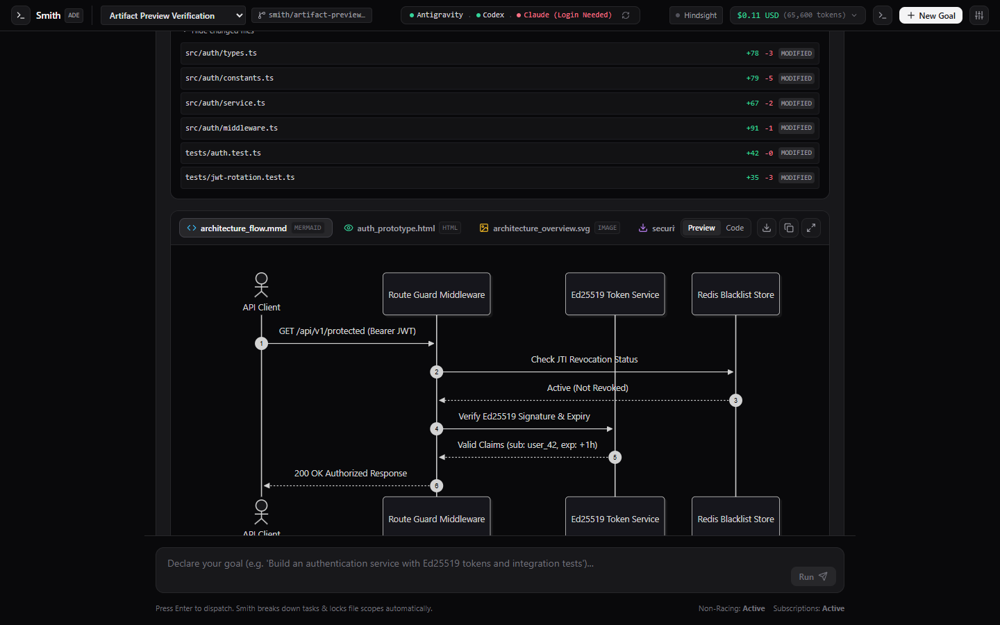

---

## Table of Contents
1. [Core Capabilities & Value Proposition](#1-core-capabilities--value-proposition)
2. [Zero API Key Architecture: Using Your Existing Subscriptions](#2-zero-api-key-architecture-using-your-existing-subscriptions)
3. [Quick Start & Launch](#3-quick-start--launch)
4. [The Single Goal Chat Interface](#4-the-single-goal-chat-interface)
5. [Pre-Flight Health-Aware Task Routing](#5-pre-flight-health-aware-task-routing)
6. [Worktree Git Diff Preview & One-Click Merge](#6-worktree-git-diff-preview--one-click-merge)
7. [Conversational Delta-Planning](#7-conversational-delta-planning)
8. [Embedded In-App Terminal & Quick Login](#8-embedded-in-app-terminal--quick-login)
9. [Cooperative Multi-Agent Protocol Behind the Scenes (arXiv:2610.22319)](#9-cooperative-multi-agent-protocol-behind-the-scenes-arxiv261022319)
10. [Inspecting Behind-the-Scenes Operations](#10-inspecting-behind-the-scenes-operations)
11. [In-IDE Broadcast Chat Layer & Peer Negotiation](#11-in-ide-broadcast-chat-layer--peer-negotiation)
12. [Per-Session Dual-Layer Persistent Memory & Compaction Survival](#12-per-session-dual-layer-persistent-memory--compaction-survival)
13. [The Observer Agent: Independent Safety & Verification Harness](#13-the-observer-agent-independent-safety--verification-harness)
14. [Vectorize Hindsight Global Memory Across Sessions](#14-vectorize-hindsight-global-memory-across-sessions)
15. [Rich Artifact Previews & File Downloads (Images, Mermaid Diagrams, HTML Pages)](#15-rich-artifact-previews--file-downloads-images-mermaid-diagrams-html-pages)
16. [Real-Time USD Cost & Token Tracking](#16-real-time-usd-cost--token-tracking)
17. [Session Customizations (Plugins, Skills, Custom MCP)](#17-session-customizations-plugins-skills-custom-mcp)
18. [REST & WebSocket API Guide](#18-rest--websocket-api-guide)

---

## 1. Core Capabilities & Value Proposition
Traditional multi-agent setups suffer from major roadblocks:
- **Exorbitant API Costs**: Wrapping agents in standard pay-per-token API keys rapidly drains budgets when running dozens of parallel reasoning loops.
- **Agent Collisions & Race Conditions**: Multiple agents working in parallel overwrite each other's files, corrupt Git state, or duplicate work.
- **Fragmented, Complex UIs**: Requiring developers to switch between 5 different tabs, manually assign tasks, and monitor separate terminals.
- **Fragile CLI Execution**: Real agent CLIs (`claude`, `codex`) hang when prompted non-interactively or throw usage limits without proactive failovers.

**Smith solves this with:**
- **Single Goal Interface**: You declare your goal; Smith decomposes, coordinates, and executes it end-to-end.
- **Pre-Flight Health-Aware Routing**: Real-time probes detect rate limits (`codex`) or missing auth (`claude`) before DAG creation, auto-routing tasks to ready agents (`@antigravity`) with explicit UI indicator pills.
- **Worktree Diff Preview & One-Click Merge**: Completed goals display inline diff cards (`+lines / -lines`, per-file diff accordion, clean merge verification) with `[Merge to main]` and `[Discard]` actions.
- **Conversational Delta-Planning**: Follow-up messages create focused single-task deltas locking only affected files instead of regenerating cumbersome 3-phase macro plans.
- **In-App Interactive Terminal**: Launch an in-app terminal modal directly from auth warning cards to run `claude login` without leaving Smith.
- **Embedded Native Semantic Vector Memory**: Subword and token sparse vector embeddings provide cosine similarity ranking and anti-pattern recall even when external databases are offline.
- **Local Subscription Harness**: Uses your existing authenticated CLI logins (`~/.claude.json`, `~/.codex`, and `~/.gemini`), consuming **$0 in token API charges**.
- **Clean, Minimalist Aesthetics**: Distraction-free neutral zinc interface with zero gaudy animations or sparkling colors.

---

## 2. Zero API Key Architecture: Using Your Existing Subscriptions

Smith operates directly on your installed command-line agent tools:
* **Claude Code (`claude`)**: Powered by your Anthropic Claude Pro / Team subscription (`claude login`). Smith automatically inherits your credentials in `~/.claude.json`.
* **OpenAI Codex (`codex`)**: Powered by your ChatGPT Plus / Team / Enterprise credentials in `~/.codex/auth.json`.
* **Google Antigravity / Gemini (`antigravity` / `gemini`)**: Powered by your Google Account and Antigravity authorization in `~/.gemini`.
* **OpenCode (`opencode`)**: Supports local models (e.g. Ollama, Qwen, DeepSeek) with 100% free offline execution.

> [!NOTE]
> No API keys are required to execute agents. All coding agents execute via native local subscription credentials.

---

## 3. Quick Start & Launch

### Prerequisites
1. **Node.js**: v18+ installed.
2. **Git**: Installed and available on system path.

### Starting the Server
```bash
# Clone or navigate to the workspace
cd johnson

# Install dependencies
npm install

# Start the Smith Orchestrator Server & Web Cockpit
npm run server
```

Open your browser to:
* **Smith UI**: `http://localhost:4100`
* **Interactive OpenAPI Swagger Docs**: `http://localhost:4100/api/docs`

### Creating a New Session

Click the **`+ New Session`** button in the top navigation bar to open the **New Session** dialog:

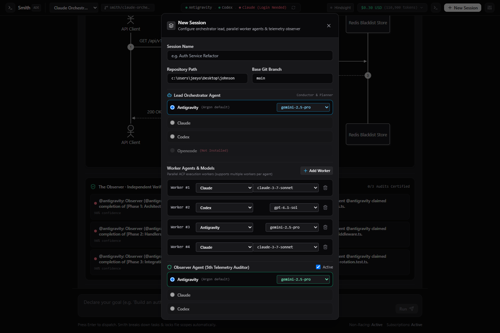

This dialog enables you to configure the session environment without forcing an upfront goal declaration:
1. **Name the Session**: Assign a descriptive identifier (e.g. *"Distributed Event Sourcing Architecture"*).
2. **Configure Isolated Worktree**: Set the disk repository path and the base Git branch. Smith creates an isolated Git worktree so that agents never touch or corrupt your current working tree directly.
3. **Allocate Worker Agent Models**: Selectively enable or disable worker agents (`@claude`, `@codex`, `@antigravity`, `@opencode`) and assign specific model versions to each agent.
4. **Configure Observer Agent & Model**: Pick the 5th independent telemetry auditor agent and select its model from the discovered models list using the same dropdown format. The Observer evaluates telemetry, catches hallucinations, and certifies milestones autonomously using its native judgment and instincts.

Once created, Smith takes you directly into the new chat session where you discuss, refine, and declare your engineering goals:

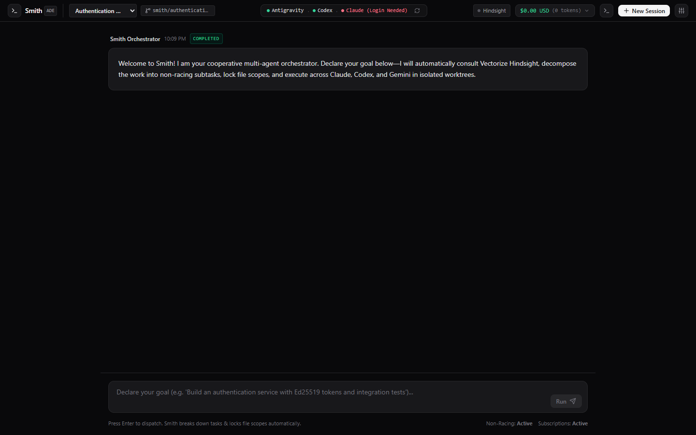

---

## 4. The Single Goal Chat Interface


The central experience is a unified, conversational goal stream:
- **Declaring a Goal**: Type your high-level objective into the bottom input prompt (e.g. *"Build an authentication service with Ed25519 tokens, route guards, and integration tests"*) and press `Enter`.
- **Cooperative Plan Card**: Smith renders the decomposed subtask DAG inline with:
  - **Task Title**: Phase description.
  - **Assigned Agent**: `@claude`, `@codex`, or `@antigravity`.
  - **Locked File Scope**: Non-overlapping file patterns with lock badges.
  - **Live Status**: Spinner for in-progress tasks, green checkmarks for completed phases.
  - **Task Compute Cost**: Real-time USD cost accrued by that specific task.
- **Resource Summary**: Displays total tokens consumed, equivalent USD compute cost, and verified `$0.00` in API subscription charges.

---

## 5. Pre-Flight Health-Aware Task Routing

Smith probes live agent CLIs before generating tasks. If an agent is rate-limited (e.g. `codex` usage limit reached) or unauthenticated (e.g. `claude` requires login):
1. **Warning Card**: The chat bubble displays an alert banner explaining the condition, reset time, and remediation.
2. **Auto-Fallback**: Tasks intended for the blocked agent are automatically rerouted to a ready agent (e.g. `@antigravity`).
3. **UI Pill**: The task badge displays `@antigravity (routed from @claude)` with a tooltip explaining the reason.

---

## 6. Worktree Git Diff Preview & One-Click Merge

When a goal completes, Smith inspects the session worktree branch and renders an inline Git review card:

- **Summary Stats**: Total insertions (e.g. `+370`), deletions (`-32`), and affected files count.
- **File Accordion**: Expandable view of modified and added files with per-file diff stats.
- **Merge to main**: One-click button (`[Merge to main]`) executes a clean non-fast-forward merge into your `main` branch.
- **Discard**: Discards worktree branch changes cleanly if you wish to reset.

---

## 7. Conversational Delta-Planning

When you ask a follow-up question or request an edit (e.g. *"Add unit test verifying expired token rejection and clock skew"*):
- Smith detects an existing completed plan in the conversation history.
- Instead of re-planning a massive 3-phase macro DAG, Smith executes a **conversational delta**:
  - Creates a single, targeted subtask (e.g. `Delta: Test Suite & Verification Update`).
  - Locks only the specific affected file scope (e.g. `tests/*`).
  - Preserves unaffected code in the active worktree branch.

---

## 8. Embedded In-App Terminal & Quick Login

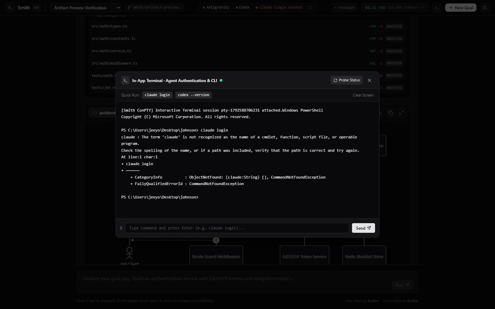

Need to authenticate Claude or Codex without opening external terminal windows?
- Click **"Launch Terminal Auth"** on any auth warning card or click the terminal icon in the header.
- An interactive in-app ConPTY terminal opens right inside Smith.
- Quick-run buttons let you execute `claude login` or check CLI versions with a single click.
- Closing the modal automatically re-probes agent health, instantly updating status badges across the UI.

---

## 9. Cooperative Multi-Agent Protocol Behind the Scenes (arXiv:2610.22319)

Smith's backend enforces the multi-agent coordination principles described in the cooperative planning literature (arXiv:2610.22319):
1. **Automatic Decomposition**: The user's single goal is broken into sequential and parallel phases with explicit file scopes.
2. **Atomic Task Leases**: Before an agent begins editing code, it must claim an exclusive lease on its file scope.
3. **Collision Avoidance**: If another agent attempts to touch overlapping paths, Smith rejects the claim with a `409 Conflict (TaskConflictError)`. The secondary agent waits or shifts to an independent task.
4. **Handoffs & Unblocking**: When a phase completes, its file locks are immediately released, automatically unblocking downstream dependent tasks.

---

## 10. Inspecting Behind-the-Scenes Operations

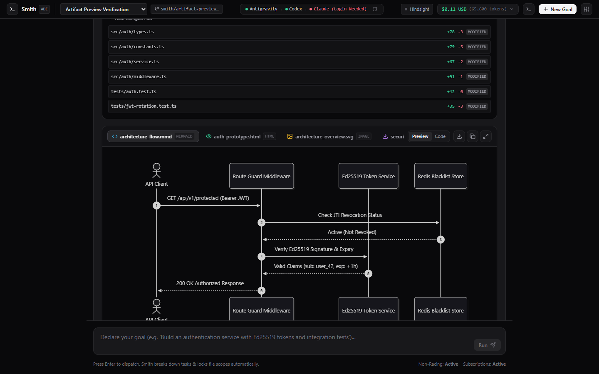

Click **"Behind the scenes"** on any orchestrator message to toggle the unified agent telemetry drawer. It provides interactive tabs:
- **Operations Stream**: Timestamped audit log of all atomic lock claims, tool operations, code edits, and lock releases.
- **Dual-Layer Memory**: Real-time view of the synchronized team workspace and private agent scratchpads.
- **Peer Broadcast**: Live stream of peer proposals, consensus votes, emergency coordinate alerts, and error retractions.
- **Observer Telemetry**: Independent passive audit records, confidence metrics, and ground-truth validation checks.

---

## 11. In-IDE Broadcast Chat Layer & Peer Negotiation

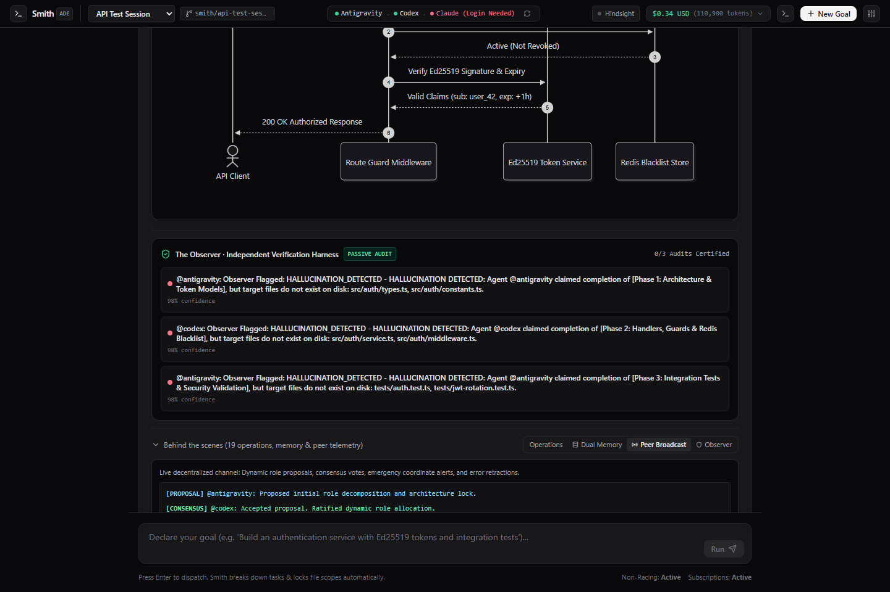

Smith implements a decentralized broadcast channel inspired by multi-agent cooperative game architectures:

1. **Dynamic Task Proposals & Consensus**:
   - Rather than relying solely on rigid top-down coordination, agents can broadcast proposals (e.g. `@codex proposes role: Redis blacklist token store`).
   - Teammates review proposals and cast consensus votes (`agree` / `disagree`), ratifying task allocations dynamically.

2. **Emergency Coordinate Alerts & Salvage Deadlines**:
   - When an agent encounters a critical build failure, test crash, or rate limit lockout, it broadcasts an `emergency_alert` with exact coordinates (file path, line number, exit code, and a salvage deadline).
   - Nearby ready teammates immediately claim the affected file scope to resolve the issue before timeout.

3. **Error Retractions & Ground-Truth Corrections**:
   - Agents broadcast `error_retraction` messages to withdraw faulty hypotheses, invalid test mocks, or incorrect schema assumptions, preventing teammates from propagating errors.

4. **Direct Turn Context Ingestion**:
   - Broadcast messages are automatically buffered and injected into the prompt and context window of peer agents at the start of their subsequent execution cycle.

---

## 12. Per-Session Dual-Layer Persistent Memory & Compaction Survival

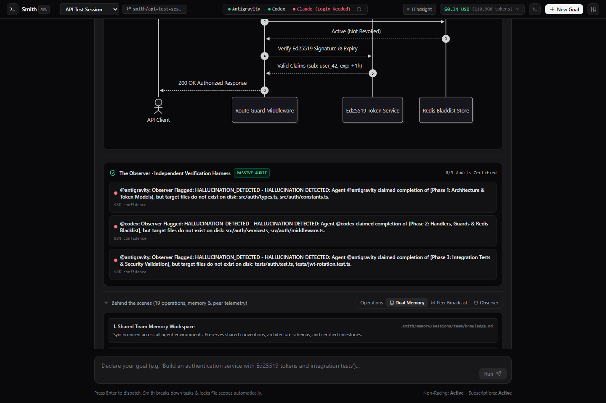

Each session in Smith maintains an isolated dual-layer memory directory under `.smith/memory/sessions/{sessionId}`:

```
.smith/memory/sessions/{sessionId}/
├── team/
│   └── knowledge.md            # Synchronized shared team workspace
└── agents/
    ├── antigravity/
    │   └── scratchpad.md       # Private agent task stack & working state
    ├── codex/
    │   └── scratchpad.md       # Private agent task stack & working state
    └── claude/
        └── scratchpad.md       # Private agent task stack & working state
```

1. **Shared Team Workspace (`team/knowledge.md`)**:
   - Synchronized across all agents assigned to the session.
   - Preserves architectural agreements, API schemas, conventions, and certified milestones.

2. **Private Agent Scratchpads (`agents/{agentId}/scratchpad.md`)**:
   - Isolated working space for each agent's execution stack, local hypotheses, and turn notes, preventing teammate cross-talk.

3. **Compaction Survival Routine**:
   - Because day-long coding sessions exceed context window limits, the harness prompts agents to push durable discoveries into `team/knowledge.md` before compaction.
   - The private scratchpad is compacted cleanly, ensuring crucial domain facts survive context roll-overs.

---

## 13. The Observer Agent: Independent Safety & Verification Harness

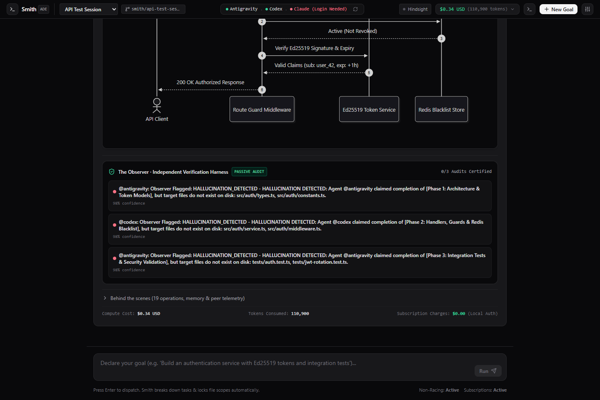

Smith features a dedicated, non-coding 5th agent instance—**The Observer** (`@observer`).

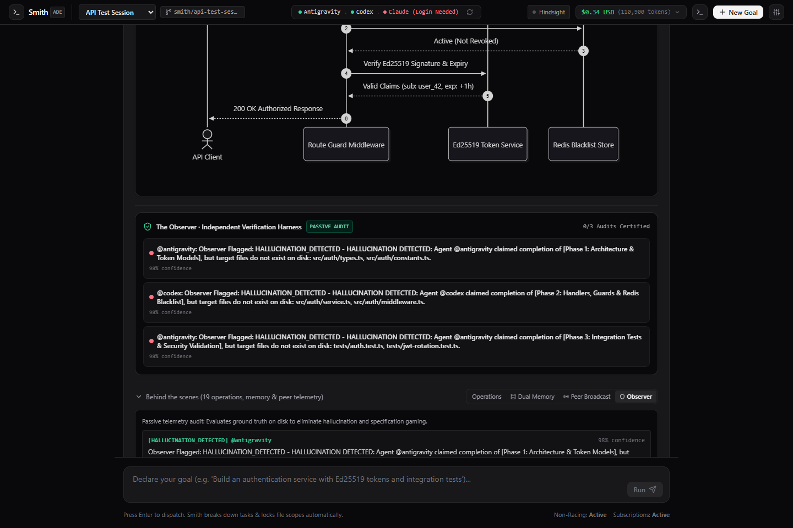

The Observer passively audits execution traces, git worktrees, and program outputs without participating in coding tasks:
- **Hallucination Detection**: Verifies that files claimed to be modified actually exist on disk and match AST requirements.
- **Specification Gaming Detection**: Detects anti-patterns such as empty test blocks (`test("...", () => {})`), `@ts-ignore` abuse, hardcoded `return true` bypass stubs, or deleted assertions.
- **Milestone Ground-Truth Certification**: Certifies completion milestones (e.g. `[Milestone Verified: Token & Route Guard Security Specifications Satisfied]`) before results are marked complete.

---

## 14. Vectorize Hindsight Global Memory Across Sessions

While dual-layer memory provides isolated per-session workspaces, **Vectorize Hindsight** powers global memory across all sessions and projects:
- **`@vectorize-io/hindsight-all` Daemon Supervisor**: Spawns and supervises the local Hindsight server on port 8888.
- **`@vectorize-io/hindsight-client` SDK**: Provides typed SDK methods (`createBank`, `retain`, `recall`, `reflect`).
- **Embedded Semantic Vector Engine (Offline Fallback)**:
  - Generates character 3-gram sparse vectors and computes cosine similarity ranking.
  - Retains shared anti-patterns so mistakes made in one session are never repeated in future sessions.

---

## 15. Rich Artifact Previews & File Downloads (Images, Mermaid Diagrams, HTML Pages)

Agents collaborating on complex engineering goals frequently produce rich deliverables: architecture diagrams, frontend UI mockups, interactive HTML prototypes, and audit reports.

Smith automatically parses and renders these artifacts with dedicated interactive previewers inside the chat timeline, while providing clean download cards for other file formats.

```
┌────────────────────────────────────────────────────────────────────────┐
│                     Smith Artifact Rendering Pipeline                  │
├────────────────────────────────────────────────────────────────────────┤
│ • Mermaid Diagrams (.mmd / ```mermaid) -> Client-side SVG rendering   │
│ • HTML Pages (.html / ```html)          -> Sandboxed interactive iframe│
│ • Images (.png, .jpg, .svg)            -> Responsive zoom/fit lightbox │
│ • Other Files (.json, .pdf, .zip, etc.)-> Clean card + Download button │
└────────────────────────────────────────────────────────────────────────┘
```

### 15.1. Mermaid Diagrams (Live Interactive SVG)


When an agent generates a `.mmd` file or outputs a ````mermaid ... ```` markdown code block:
- **Client-Side Rendering**: Smith's built-in Mermaid v12 engine compiles the diagram directly into clean, sharp SVG vectors with dark-theme styling.
- **Tabbed Interface**: Each artifact appears as an organized tab at the bottom of the completed orchestrator message.
- **Source Code Toggle**: Click **"Code"** to view and copy the raw Mermaid source syntax, or click **"Preview"** to inspect the rendered diagram.
- **Direct Download**: Use the **"Download"** button to export the diagram file directly from the worktree.

---

### 15.2. Interactive HTML Web Prototypes (Sandboxed Preview)

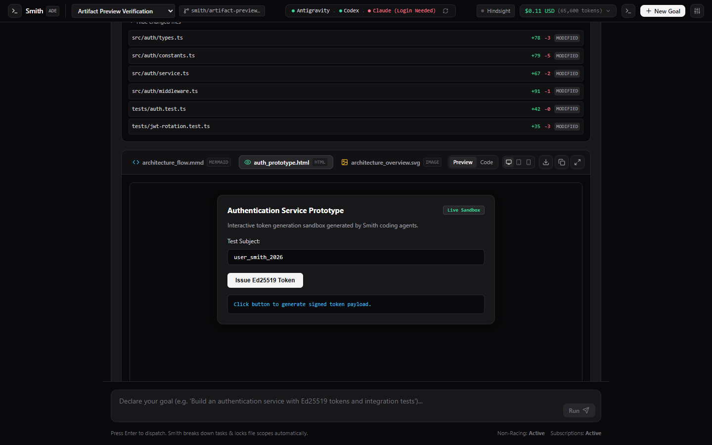

When an agent creates an HTML prototype (e.g. `auth_prototype.html` or inline ````html ```` snippets):
- **Isolated Sandbox**: Rendered inside a secure `<iframe>` with strict sandbox restrictions (`allow-scripts allow-forms allow-same-origin allow-modals`), preventing unauthorized access to the host ADE application.
- **Device Viewport Toggles**: Easily preview responsive layouts across three standard viewport widths:
  - **Desktop**: Full 100% container width.
  - **Tablet**: Fixed 768px width.
  - **Mobile**: Fixed 375px width.
- **Live Interaction**: Buttons, inputs, forms, and local state in the prototype work interactively within the frame.
- **External Launch**: Click **"Open"** to view the prototype in a dedicated browser tab, or click **"Code"** to inspect the HTML markup.

---

### 15.3. Inline Image Previews

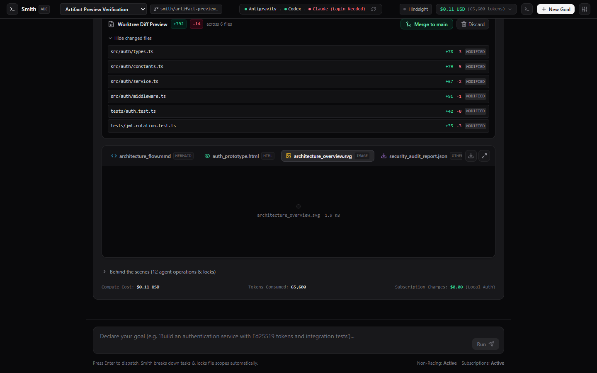

For visual assets (`.svg`, `.png`, `.jpg`, `.jpeg`, `.webp`, `.gif`):
- **Responsive Display**: Images are centered on a subtle checkered canvas with automated aspect-ratio preservation.
- **Fit & Zoom**: Toggle between **"Fit to Container"** and **"Actual Size (100%)"** to inspect high-resolution designs or micro-icons.
- **One-Click Download**: Download the asset directly to your local file system.

---

### 15.4. Download Cards for Other File Types

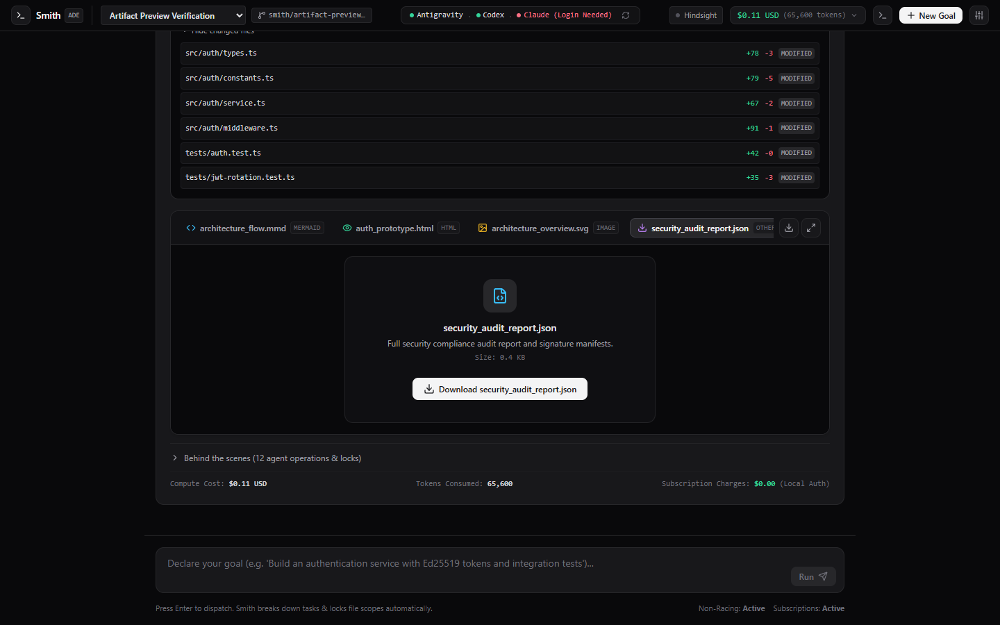

For non-visual or data files (e.g. `security_audit_report.json`, `.csv`, `.pdf`, `.tar.gz`, or binaries):
- **Clean Card UI**: Avoids cluttering the chat with raw binary or lengthy structured data.
- **File Metadata**: Displays the file name, extension pill, file size, and direct relative path within the worktree.
- **Direct Download**: Click the prominent **"Download File"** button to trigger an HTTP attachment download (`Content-Disposition: attachment`) served directly from the agent's isolated Git worktree.

---

## 16. Real-Time USD Cost & Token Tracking

Even though your agents execute on flat subscriptions, developers need visibility into resource consumption:
- **Header Cost Widget**: Shows total compute cost (e.g. `💵 $0.20 USD (65.6k tokens)`).
- **Cost Modal**: Click the cost widget to open a breakdown showing total tokens, cost per agent, and turn metrics.

---

## 17. Session Customizations (Plugins, Skills, Custom MCP)

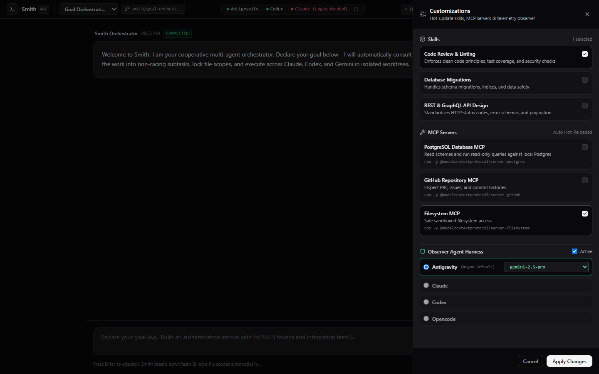

Click the **Sliders** icon in the header to configure session capabilities:
- **Active Skills**: Enable or disable standard operating procedures (`code-review`, `database-migrations`).
- **Custom MCP Servers**: Attach external Model Context Protocol tools.
- **Hot-Reloading**: Changes take effect immediately without restarting agent sessions or losing worktrees.

---

## 18. REST & WebSocket API Guide

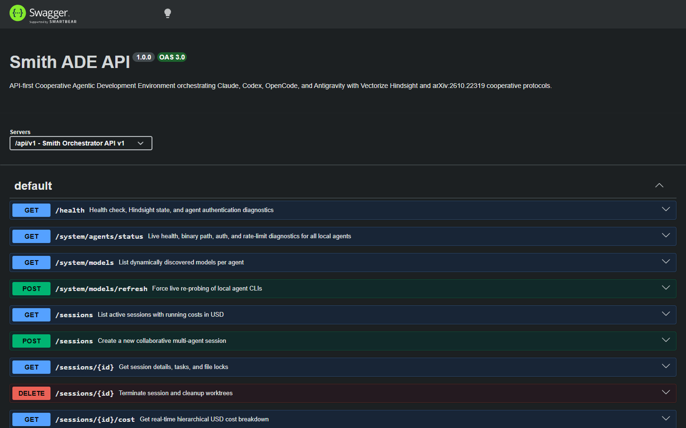

Smith is 100% API-first. You can control everything programmatically:

### Key API Endpoints (`/api/v1`)
- `GET /api/v1/sessions/:id/chat`: Full chronological chat timeline for the single chat interface.
- `POST /api/v1/sessions/:id/goal`: Declare a goal and trigger cooperative multi-agent execution.
- `GET /api/v1/sessions/:id/worktree/summary`: Structured per-file diff summary and merge check.
- `GET /api/v1/sessions/:id/worktree/file?path=<path>&download=1`: Stream or download worktree files with strict directory traversal validation.
- `GET /api/v1/sessions/:id/worktree/artifacts`: List all generated artifacts (images, HTML, Mermaid, reports) with detected types.
- `GET /api/v1/sessions/:id/memory/dual-layer`: Get paths, shared `team/knowledge.md` workspace, and private scratchpads.
- `POST /api/v1/sessions/:id/memory/compaction-flush`: Trigger pre-compaction survival flush of durable state.
- `GET /api/v1/sessions/:id/observer/audits`: Query The Observer Agent independent telemetry audits and milestone certifications.
- `GET /api/v1/sessions/:id/broadcast/peer-state`: Query live broadcast layer proposals, consensus votes, and emergency alerts.
- `POST /api/v1/sessions/:id/worktree/merge`: Merge worktree changes cleanly into `main`.
- `POST /api/v1/sessions/:id/worktree/discard`: Discard unmerged worktree modifications.
- `POST /api/v1/system/pty/create`: Spawn an interactive ConPTY session for auth or CLI commands.
- `GET /api/v1/health`: Server health, Git status, agent health statuses, and Hindsight connectivity.
- `GET /api/v1/system/agents/status`: Live probed agent authentication and rate limit diagnostics.
- `GET /api/v1/system/agents/status`: Live probed agent authentication and rate limit diagnostics.

Interactive Swagger UI: `http://localhost:4100/api/docs`  
OpenAPI 3.0 JSON: `http://localhost:4100/api/v1/openapi.json`
