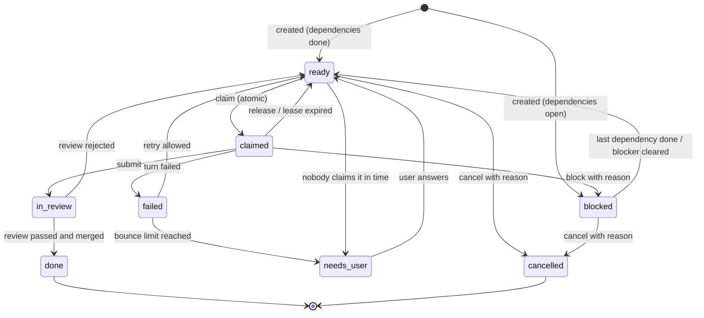

# Peer Board: leaderless agent teams on a shared kanban

Status: implemented (see section 19 for where the code differs)
Target platform: macOS

## 1. Summary

Smith's purpose is for a team of coding agents to divide a goal among themselves, plan together on one shared board, and change the plan when work does not go as expected. No agent is in charge.

Today the server does the opposite. `GoalOrchestrator` builds a fixed plan from keywords, walks the task list in a loop, and claims, completes and broadcasts on each agent's behalf. Agents never see the board and the plan cannot change after it is created.

This design replaces that loop with three parts:

1. **The board**: a persisted, versioned kanban that is the only state the agents share.
2. **Board tools**: a real MCP server through which each agent reads and changes the board.
3. **The scheduler**: a loop that wakes idle agents when there is something for them to look at. It never decides who does what.

Conversation with the user (brainstorming, drafting and reviewing the spec) stays in a single harness and is out of scope here. This design starts when that harness hands over an approved spec.

## 2. Goals and non-goals

### Goals

- Agents pull work from the board; nothing assigns it to them.
- Any agent can change the plan: add, split, block, cancel or hand back a card, with a recorded reason.
- The plan adapts on its own when a card fails, is blocked, or its result fails review.
- Several agents work at the same time without overwriting each other.
- The user can see the board, every change to it, and why each change was made.
- Work stops and asks the user when the team is stuck, instead of looping.

### Non-goals

- No lead, manager or orchestrator agent.
- No voting or consensus protocol.
- No long-lived agent processes in the first version. Agents run as one-shot turns.
- No cross-session memory. Hindsight is removed (section 14).
- No Antigravity support. It is removed from the agent list (section 14).
- No Windows or Linux support work in the first version.

## 3. Concepts

| Term | Meaning |
|---|---|
| Board | All cards for one session, plus a version number and a change log. |
| Card | One unit of work with an owner, a state, a file scope and acceptance criteria. |
| Thread | The ordered notes on a card. This replaces the team bus and the scratchpads. |
| Peer | One configured worker (for example `claude-1`). All peers have the same rights. |
| Harness | An agent CLI (Claude Code, Codex, OpenCode). Each peer runs its turns on one harness and model. |
| Tier | A number from 1 to 3 describing how capable a peer's current model is. |
| Turn | One one-shot run of a peer's CLI, given the board and one reason for waking. |
| Lease | A peer's time-limited ownership of a card. |
| Referee | The board's rule checks. It accepts or rejects a change; it never proposes one. |

## 4. The board

### 4.1 Card

```ts
interface Card {
  id: string;
  title: string;
  description: string;
  acceptance: string[];        // required; a card without criteria is rejected
  kind: 'work' | 'review' | 'verify' | 'merge-conflict';
  state: CardState;
  owner?: PeerId;
  leaseExpiresAt?: number;
  fileScope: string[];         // paths or globs the card may change
  dependsOn: string[];         // card ids that must be done first
  minTier?: 1 | 2 | 3;         // lowest peer tier allowed to claim it; unset means any
  parentId?: string;           // set when the card came from a split or delegation
  createdBy: PeerId | 'spec' | 'board';
  delegationChain: PeerId[];   // peers that have handed this card on
  bounces: number;             // times it returned to ready after being claimed
  branch?: string;             // set when claimed
  result?: { commit?: string; summary: string };
  thread: Note[];
}

type CardState =
  | 'ready' | 'claimed' | 'in_review' | 'done'
  | 'blocked' | 'failed' | 'cancelled' | 'needs_user';

interface Note {
  author: PeerId | 'board' | 'user';
  at: number;
  kind: 'comment' | 'proposal' | 'decision' | 'blocker' | 'result';
  text: string;
  proposal?: BoardEdit;        // present on kind 'proposal'
}
```

### 4.2 States



### 4.3 Versioning and log

The board has an integer `version` that increases on every accepted change. Every change request carries the version the peer last read. A request based on an older version is rejected with the current board, and the peer must re-read before trying again. This is how two peers editing the plan at once are kept from overwriting each other without a lead.

Every accepted change is appended to a log: who, when, what changed, and the reason given. The log is what the user reads to understand why the plan moved.

### 4.4 Storage

One JSON file per session at `~/.smith/boards/<sessionId>.json`, written atomically (write to a temp file, then rename). The log is a separate append-only file beside it. The board is loaded at startup, so a restart does not lose the plan. Leases that expired while the app was closed are released on load.

## 5. Referee rules

The server enforces these on every change. They are the whole of the coordination logic.

1. **Claim.** A card can be claimed only when it is `ready`, all `dependsOn` cards are `done`, the peer is under its work-in-progress limit, and the peer's current tier is at least the card's `minTier`. The first claim wins.
2. **Ownership.** Only the owner can submit, release or block a claimed card.
3. **Editing.** Any peer can edit or cancel a card that has no owner. A change to a card owned by someone else is stored as a proposal note; the owner accepts or rejects it on their next turn.
4. **Scope.** The file scopes of two claimed cards must not overlap. A claim that would overlap is rejected and names the conflicting card.
5. **Scope is checked on submit.** The diff on the card's branch is compared with its `fileScope`. A change outside the scope rejects the submit. The peer can then either undo the stray change or ask to widen the scope, which rule 4 checks again.
6. **Review is by someone else.** A `review` card cannot be claimed by the peer that owned the work card it reviews.
7. **Delegation.** A card cannot be handed to a peer already in its `delegationChain`, and the chain cannot be longer than the configured depth.
8. **Leases expire.** A claimed card whose lease has passed returns to `ready` and its `bounces` count increases.
9. **Acceptance is required.** Creating or splitting a card without acceptance criteria is rejected.
10. **The spec is read-only.** No tool changes the spec file, and a submit whose diff touches it is rejected. A peer that thinks the spec is wrong uses `ask_user` (section 10.2).
11. **No second attempt while others are free.** A peer cannot re-claim a card it has failed or had rejected in review while another eligible peer is idle.

## 6. Board tools (MCP server)

The existing tool list in `src/server/mcp-gateway.ts` becomes a real MCP server. Each peer's CLI connects to it for the length of a turn. Calls are tied to a peer by a per-turn token, so a peer cannot act as another.

| Tool | Purpose |
|---|---|
| `board_read` | Return the board, its version, and the caller's open proposals. |
| `card_claim` | Claim a ready card. Creates the card's branch and worktree. |
| `card_note` | Add a comment to a card's thread. |
| `card_submit` | Hand in a claimed card with a summary. Triggers the scope check and creates a review card. |
| `card_release` | Give a claimed card back, with a reason. |
| `card_block` | Mark a card blocked, with the reason and what would unblock it. |
| `card_create` | Add a card (title, description, acceptance, scope, dependencies). |
| `card_split` | Replace a card with two or more smaller cards. |
| `card_edit` | Change an unowned card, or propose a change to an owned one. |
| `card_cancel` | Cancel an unowned card, with a reason. |
| `card_delegate` | Offer a card to a named peer. |
| `proposal_answer` | Accept or reject a proposal on a card the caller owns. |
| `review_verdict` | Pass or reject a review card, with findings. |
| `ask_user` | Move a card to `needs_user` with one question. |

Removed from the current list: `broadcast_proposal`, `vote_consensus`, `broadcast_emergency_alert`, `broadcast_error_retraction`, the scratchpad tools and `flush_compaction_survival`. Card threads, the blocked state and proposals cover their uses.

### Attaching the server to each CLI

- **Claude Code** (verified on this machine, v2.1.311): `claude -p <prompt> --mcp-config <file> --output-format json --allowedTools ...`. The JSON output also reports real token usage, which replaces the length-based estimate.
- **OpenCode** (installed here): MCP servers are set in its config file. The exact per-run mechanism is not yet verified.
- **Codex**: not installed on this machine. Believed to read MCP servers from its config; not verified.

## 7. The scheduler

The scheduler is a loop inside the server. It holds no opinion about the plan.

```
on any board change, turn end, or timer tick:
  release expired leases
  for each idle, healthy peer (in rotating order):
    reason = first match of:
      1. a proposal is waiting on a card the peer owns
      2. a card the peer owns changed (rejected review, answer from user, unblocked)
      3. there is a card the peer is allowed to claim
    if reason: start a turn for that peer with that reason
  if no turn is running and nothing is claimable:
    if every card is done or cancelled: create the final verify card (once)
    else: mark the goal stalled and ask the user
```

A peer that is logged out is skipped; its leases run out and its cards return to the board. A peer whose harness runs out of usage is removed from the team (section 7.1). This replaces the pre-flight rerouting in `GoalOrchestrator`.

Peers are woken in rotating order so one fast peer does not take every card.

### 7.1 Usage limits

There is no fallback. A harness that hits its usage limit leaves the team.

- When a turn returns a usage-limit error, every peer on that harness and model is removed from the session's team. Other peers carry on.
- Cards the removed peers held return to `ready`. This is not a failure, so the cards do not bounce. Each card keeps its branch and worktree, and the board notes on its thread what happened, so the next peer to claim it continues from the files already on disk.
- Proposals waiting on a removed peer's cards stay on the cards and are answered by whoever claims them next.
- The removal is recorded in the board log and shown in the UI with the reset time, when the error gives one.
- A removed peer rejoins the team by itself. If the error gave a reset time, it rejoins at that time; otherwise the scheduler checks the harness every few minutes with a call that does not spend usage, and the peer rejoins when the check passes. If its first turn back hits the limit again, it is removed again.
- A peer that rejoins starts with no cards. It claims from the board like any other peer; cards it held before are not handed back to it.
- If one peer remains, reviews cannot be done by someone else, so the session behaves as in Fast mode (section 10.1) and the UI says so.
- If no peer remains, the goal pauses and the user is told why and when the earliest reset is.

### 7.2 Peer tiers

Workers are normally set to similar models, and then tiers do nothing. They matter when a user gives workers models of different strength.

- Each worker has a tier from 1 to 3. Smith suggests one from the model when the worker is configured (for example a small or local model is 1, a flagship model is 3); the user can change it.
- A card may carry `minTier`. It can be set by the spec, or by any peer through `card_create`, `card_split` or `card_edit`, with a reason, under the normal editing rule.
- The board raises `minTier` itself in one case: when a card has bounced twice from peers of the same tier and a higher-tier peer exists, `minTier` becomes that tier plus one.
- A card whose `minTier` no peer on the team can meet moves to `needs_user`. This can happen when a higher-tier peer is removed for a usage limit.

Rule 11 covers the common case without tiers: a card that one peer could not finish goes to a different peer next.

### A turn

A turn is one one-shot CLI run. The prompt carries enough of the board to act and no more:

- the goal and the path of the approved spec (the path, not the contents),
- the reason for waking,
- one line per open card: id, title, state, owner, scope,
- one line per done card: id, title, result summary,
- the full thread of the card the turn is about, and the result summaries of the cards it depends on,
- the rules a peer needs to know (sections 5 and 6, shortened).

Threads of other cards are left out; a peer that needs one calls `board_read` for it. Notes have a length cap, and a result summary is at most a few sentences, so the prompt grows with the number of cards and not with the amount of discussion.

The peer works in its card's worktree and uses the board tools to record what it did. A turn that ends without submitting, releasing or blocking its card leaves the card claimed until the lease expires; the scheduler wakes the peer again before that to continue.

Because each turn starts with no memory of earlier turns, everything a peer needs later must be written to the card's thread. This is deliberate: the board is the team's memory.

## 8. Changing the plan

Nothing special handles replanning. It is the result of ordinary tools plus three triggers.

| Trigger | What the board does | What a peer is likely to do |
|---|---|---|
| A turn fails or a lease expires | Card returns to `ready`, `bounces` + 1, failure noted on the thread | Retry, split the card, or block it with a reason |
| A review is rejected | Work card returns to `ready` with the findings on its thread | Fix it, or propose a different approach to dependants |
| A peer finds the plan is wrong | Nothing until the peer acts | `card_create`, `card_split`, `card_cancel`, or a proposal on someone else's card |
| A merge conflicts | A `merge-conflict` card is created, scoped to the conflicting files | Claim and resolve it |

Example: card B ("add route guards") depends on card A ("token types"). While working on B, `claude-2` finds that A's types lack a field. It adds a proposal to A. A's owner, `opencode-1`, is woken with reason 1, accepts, and creates a small follow-up card. B is blocked on the follow-up, then unblocks on its own when it is done. The log shows each step and its reason.

## 9. Worktrees and merging

- The session keeps its branch and worktree as today (`smith/<session>`).
- Claiming a card creates `smith/<session>/<cardId>` from the session branch, in its own worktree. Peers never share a working directory.
- When a review passes, the card branch is merged into the session branch. If the merge conflicts, it is aborted and a `merge-conflict` card is created.
- Card worktrees are removed when the card is done or cancelled.
- Merging the session branch into the user's base branch stays a user action, as now.

All git commands go through `WorktreeManager`, which already refuses to act in a directory that is not its own worktree root.

## 10. Review, verification and done

### 10.1 Review modes

The user picks a review mode per session and can change it at any time; the change applies to cards submitted afterwards.

| Mode | When a submitted work card gets a review card |
|---|---|
| Fast | Never. For small goals. |
| Normal (default) | When the card is complex (below). |
| Thorough | Always. |

In Normal mode the board decides "complex" from facts, so that no agent has to judge it. A card is complex if any of these is true:

- its diff changes more than 150 lines or more than 5 files,
- the spec marked the task as needing review,
- its author asked for a review when submitting,
- it has bounced at least once.

The two size thresholds are session settings. A card that needs no review is merged on submit and moves straight to `done`.

A review card can be claimed by any other peer. The reviewer gets the spec, the card and the diff, and nothing else. A turn with no history is the fresh view a review needs. With a single configured peer no review is possible; the UI says so and the session behaves as in Fast mode.

The final verification below runs in every mode, including Fast.

### 10.2 Spec changes

The spec is what the user approved, so peers cannot change it. A peer that finds the spec wrong or incomplete calls `ask_user` with the problem and what it proposes. The card moves to `needs_user`, and cards that depend on it stay blocked. The user either answers within the existing spec, or edits the spec through the user-facing harness. After an edit the board notes the change on every open card whose scope or acceptance the edit touches, and wakes their owners.

### 10.3 Verification and done

- When every card is done or cancelled, the board creates one `verify` card: run the project's test and build commands, and compare the result with the spec's acceptance criteria. Its result reports which commands ran and their exit codes. No confidence score is produced.
- The goal is complete when the verify card is done. If it fails, the peer that holds it creates cards for what is wrong, and work continues.

The verify commands come from the spec. If the spec names none, the verify card asks the user.

## 11. Limits

All have defaults and are set per session.

| Limit | Default | When reached |
|---|---|---|
| Cards in progress per peer | 1 | Further claims rejected |
| Lease length | 20 minutes, renewed by each turn | Card returns to ready |
| Bounces per card | 3 | Card moves to `needs_user` |
| Delegation chain length | 2 | Delegation rejected |
| Plan edits per goal | 40 | Further edits need the user's approval |
| Turns per goal | 60 | Goal pauses and asks the user |
| Time a ready card may wait | 30 minutes with idle peers | Card moves to `needs_user` |

The numbers are starting guesses. They need tuning against real runs.

## 12. Hand-off from the spec

The harness that talks to the user produces an approved spec file in the session worktree. The spec ends with a task list; each entry has a title, description, acceptance criteria, file scope and dependencies. The server turns each entry into a card with `createdBy: 'spec'`. No agent is involved in this step, so there is no first planner.

If the spec has no task list, the board starts with one card: "Break this spec into cards". Whichever peer claims it creates the rest.

## 13. User interface

- The plan card in the chat becomes a live board: columns for ready, in progress, in review, done, and a row for blocked and needs-you.
- Opening a card shows its thread, scope, branch and diff.
- A "Plan changes" list shows the change log with reasons.
- `needs_user` cards appear in the chat as a question the user can answer inline.
- The Behind-the-scenes tabs for peer broadcast, dual-layer memory and observer telemetry are removed; their content now lives on the cards.

The server already pushes task events over the WebSocket; the board's events replace them.

## 14. Changes to existing code

| File | Change |
|---|---|
| `src/server/task-lease-manager.ts` | Becomes `board.ts`: card model, states, version, log, lease expiry, referee rules, persistence. |
| `src/server/mcp-gateway.ts` | Becomes a real MCP server with the tool list in section 6. |
| `src/server/goal-orchestrator.ts` | Keyword planner, sequential loop and canned replies removed. What remains is chat history and the spec hand-off. |
| `src/server/scheduler.ts` | New. Section 7, including removing peers whose harness hits its usage limit. |
| `src/client/components/NewSessionModal.tsx`, session worker settings | Worker configuration gains a tier field. |
| `src/server/adapters/*` | Each gains "run a turn with this MCP config", returns real usage where the CLI reports it, and reports a usage-limit error with its reset time as a distinct result. |
| `src/server/worktree-manager.ts` | Gains per-card worktree create, merge into session branch, and diff-against-scope. |
| `src/server/broadcast-layer.ts`, `observer-agent.ts`, `session-memory.ts`, `team-bus.ts` | Removed. |
| `src/server/acp-host.ts` | Removed in this version (see alternative C). |
| `src/server/skills/elephant-goldfish.ts` | Removed; clarifying questions belong to the user-facing harness. |
| `src/server/hindsight-service.ts`, `routes/memory.router.ts` | Removed, with the Hindsight tab in `SettingsView.tsx`, the `hindsight` block in config, the startup progress step, and the `@vectorize-io/*` packages. The cask no longer depends on `uv`. |
| `src/server/adapters/antigravity.adapter.ts` | Removed, with Antigravity's entries in model discovery, pricing, settings, binary detection and the default orchestrator/observer config. This also removes the direct OpenAI API call. |
| `src/server/seed.ts` | Removed. |
| `src/client/components/PlaybookDAG.tsx`, `GoalChat.tsx`, `TeamChat.tsx` | Rebuilt around the board view. |
| Tests | Board rules get direct unit tests. The `NODE_ENV === 'test'` fakes in `worktree-manager.ts` are removed in favour of temp repositories, as `tests/hardening.test.ts` already does. |

New dependency: `@modelcontextprotocol/sdk`.

## 15. Delivery in slices

1. **Board core.** Card model, states, version, log, referee rules, persistence. Unit tests only; no agents.
2. **Board tools.** MCP server over the board, with per-turn tokens. Tested with a scripted client.
3. **Scheduler with two Claude Code peers** on one shared worktree, review cards included. This is the first point at which peers visibly claim, hand over and replan.
4. **Per-card worktrees**, scope check on submit, merge and conflict cards.
5. **Board UI** and the plan-change list.
6. **Other CLIs**: OpenCode, then Codex, once their MCP attachment is verified.
7. **Removal** of the modules listed in section 14 and an update of the user manual and architecture doc.

Each slice leaves the app working. Slices 1 to 3 are enough to judge whether the leaderless model behaves well.

## 16. Alternatives considered

**A. A lead agent owns the board.** One agent plans and assigns; others propose changes to it. Simpler to make reliable and avoids duplicate planning. Rejected because it is not the product: the point is that the team organises itself.

**B. Voting on plan changes.** Peers vote on each proposed change. Rejected: it costs a turn per voter, and models asked to vote mostly agree, so the vote adds delay without information. The owner-decides rule plus the version check gives one clear decision-maker per card.

**C. Long-lived agent sessions (ACP).** Each peer keeps a running process and its own context across the goal. Peers would react faster and re-read less. Rejected for the first version: it needs context compaction, crash recovery and a different integration per CLI, and it makes peers' private context a second source of truth beside the board. It can be revisited once the board model is proven.

**D. One shared worktree with file locks only.** No per-card branches. Simpler, and it is what slice 3 uses. Rejected as the end state because locks are honour-system: a CLI agent can write any file, and without a branch per card there is no diff to check against the scope.

## 17. Decisions and open questions

### Decided

1. **Reviews**: three selectable modes, Fast, Normal and Thorough (section 10.1).
2. **Spec changes**: always go to the user (section 10.2).
3. **Turn cost**: accepted, provided the board view in each prompt stays compact (section 7).
4. **Hindsight**: removed.
5. **Antigravity**: removed.
6. **Usage limits**: no fallback. Peers on a harness and model that hits its limit are removed from the team, their cards return to the board, and they rejoin automatically after the reset (section 7.1). There is no cap on concurrent turns per harness.
7. **Peers of different strength**: workers have a tier, and a card may set the lowest tier allowed to claim it (section 7.2).

### Open

None at present.

## 18. Risks

- **Thrash.** Leaderless teams can spend their turns rearranging the plan. The edit cap and bounce limit bound the damage; they do not make the team good at planning. Slice 3 exists to find out early.
- **Weak reviews.** A peer may pass a review card without reading the diff closely. The final verification runs real commands for this reason.
- **Quota.** More turns means more subscription usage than the current single pass, and several workers on one subscription use it up sooner. Each limit shrinks the team, and the goal pauses when no peer is left.
- **Detecting usage limits.** Removing a peer depends on recognising each CLI's usage-limit error and reset time from its output. The current adapters do this by matching text, which breaks when a CLI changes its wording.
- **Mixed work on one card.** A card may be started by one peer and finished by another after a removal. The second starts from the files on disk and the card thread, with no memory of the first one's reasoning.
- **CLI differences.** The design assumes every CLI can attach an MCP server per run. This is verified only for Claude Code.

## 19. Implementation notes

The design above is built. These are the places where the code differs from it, and what has not been checked.

### Differences

- **Two version numbers.** Section 4.3 has one board version that every change request must carry. In the code `version` counts every change, and `planVersion` counts only changes to the plan (cards created, split, edited, cancelled, blocked). Only plan-editing tools must send `planVersion`. With a single number, a teammate's note or claim would make every other peer's plan edit stale.
- **Card branch names.** Section 9 names card branches `smith/<session>/<cardId>`. Git cannot hold a branch under another branch's name, so they are `smith/<session>--<cardId>`.
- **A `plan` card kind.** Section 12's "Break this spec into cards" card has its own kind, with no worktree and no review.
- **Spec location.** A spec named by path stays in the repository. A goal typed in the chat is saved as the spec under `~/.smith/specs/`, outside the repository.
- **Spec task list format.** A fenced `smith-tasks` JSON block at the end of the spec.
- **Blocking needs an open card.** `card_block` must name at least one open card in `waitFor`. A blocker only the user can clear goes through `ask_user`. This keeps a card from being blocked with nothing that would ever unblock it.
- **Delegation is an offer.** `card_delegate` puts the card back to ready, reserved for the named peer for ten minutes, after which anyone may claim it.
- **A hint per peer.** When several peers are idle, the scheduler points each at a different claimable card so two do not race for one. The peer may still claim another.
- **Rejoin without a probe.** Section 7.1 describes a check that spends no usage for a CLI that gives no reset time. No such check exists that proves a limit has lifted, so the peer rejoins after ten minutes and its first turn is the test.
- **Silent turns.** Two turns in a row in which a peer makes no board tool call count as a failed turn. This bounds the cost when a CLI cannot reach the board.
- **A waiting state.** When every worker is away or the team is waiting for the user, the goal stays running with a `waitingReason` instead of pausing, so work resumes without the user pressing Resume.
- **No shared-worktree slice.** Per-card worktrees were built directly; the intermediate slice 3 on one shared worktree was skipped. A session whose directory is not a real Git worktree still falls back to working in that directory without scope checks or merges.
- **Proposals on unowned cards.** A proposal left on a card whose owner has since gone can be answered by any peer.

### Not verified

- **No live agent run.** The board, tools, scheduler and git flow are tested end to end with scripted peers that call the real MCP endpoint. A turn with a real CLI has not been run. Claude Code's flags were checked against the installed CLI's help; Codex and OpenCode options come from their documentation.
- **The limits in section 11** are still the starting guesses.
- **Usage-limit detection** matches error text and has only been tested against sample messages.
